<div align="center">

<picture>
  <source media="(prefers-color-scheme: dark)" srcset="assets/banner-dark.svg">
  <source media="(prefers-color-scheme: light)" srcset="assets/banner-light.svg">
  
</picture>

<br/>

[](package.json)
[](#api-reference)
[](#install)
[](#the-rates)
[](LICENSE)

</div>

## What is this?

Every UK property site ends up needing the same three things: a stamp duty calculator, a mortgage
calculator, and something to turn a weekly rent into a monthly one. And every team writes them
again, gets a band edge wrong, and finds out from a customer.

**property-calculators** is that logic, written once and tested hard. You call a function. It
hands back the numbers, plus everything you'd otherwise write yourself to show them: formatted
strings, labels, table columns and rows, form options, even the calculator's button grid.

The core is **headless**: your design system draws the UI and this tells it what to draw. In a
hurry? There are also [ready-made React components](#react-components) that look finished out of
the box and restyle with a few CSS variables.

```ts
import { calculateStampDuty } from 'property-calculators';

const estimate = calculateStampDuty({ price: 750_000 });

estimate.stampDuty;               // 27500
estimate.formatted.stampDuty;     // "£27,500"
estimate.formatted.effectiveRate; // "3.67%"
estimate.bands[2].formatted;      // { range: "£250,001 – £925,000", rate: "5%", taxable: "£500,000", tax: "£25,000" }
```

## What's inside

| | | |
| --- | --- | --- |
| **[Stamp duty](#stamp-duty)** | SDLT for home movers, first-time buyers, additional properties and non-UK residents, with the band-by-band breakdown. Also [new leases](#new-leases), [non-residential property](#non-residential-and-mixed-use) and [replacing a main home](#replacing-a-main-residence). | `property-calculators` |
| **[Mortgage](#mortgage)** | Monthly payment, total interest, loan to value, and the cash you need upfront with stamp duty included. | `property-calculators/mortgage` |
| **[Rental yield](#rental-yield)** | Gross and net yield on a buy-to-let, with stamp duty, empty weeks and running costs counted. One property or a portfolio. | `property-calculators/rental-yield` |
| **[Scotland and Wales](#scotland-and-wales)** | LBTT and LTT with the same breakdown, and one call that picks the right tax for any UK country. | `property-calculators/land-tax` |
| **[Affordability](#affordability)** | How much someone can borrow from their income, and the income a price needs. | `property-calculators/affordability` |
| **[Overpayments and remortgaging](#overpayments-and-remortgaging)** | Time and interest saved by overpaying, and whether switching deal pays for itself. | `property-calculators/overpayment` |
| **[Cost of buying](#cost-of-buying)** | Deposit, stamp duty and fees as one upfront figure, item by item. | `property-calculators/buying-costs` |
| **[Buy-to-let check](#buy-to-let-check)** | Whether the rent covers the loan the way lenders test it. | `property-calculators/buy-to-let` |
| **[Price per square foot](#price-per-square-foot)** | Price or rent per sq ft and per sq m, and how it compares with the local average. | `property-calculators/price-per-area` |
| **[Tenant deposit caps](#tenant-deposit-caps)** | The legal maximum tenancy deposit, holding deposit and rent in advance in England. | `property-calculators/tenant-deposit` |
| **[Desk calculator](#desk-calculator)** | A pocket calculator that also does VAT, rent per week ↔ per month, ft² ↔ m², and £ ↔ € or $. | `property-calculators/calculator` |
| **[React components](#react-components)** | Each calculator as a drop-in component, styled by default and themeable. Optional. | `property-calculators/react` |
| **[Branded PDFs](#branded-pdfs)** | Any result as a one-page PDF with your logo, colour and footer. No PDF library needed. | `property-calculators/pdf` |

<table>
<tr>
<td width="50%" valign="top">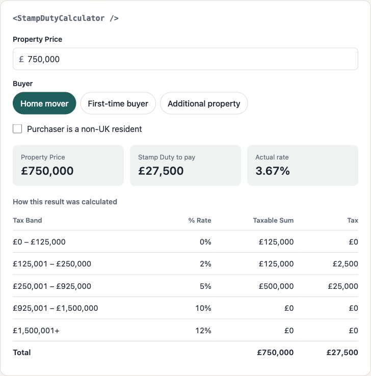<br/><sub><b>Stamp duty</b>, with the working shown</sub></td>
<td width="50%" valign="top">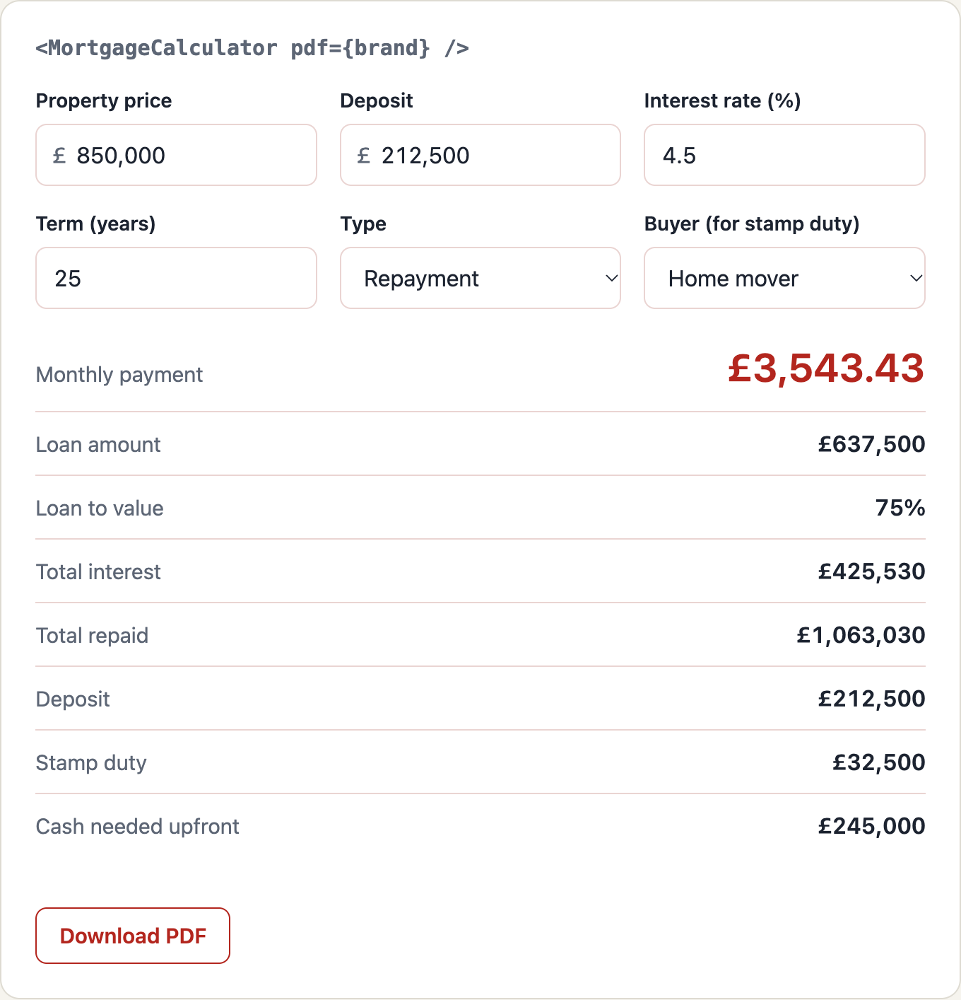<br/><sub><b>Mortgage</b>, with cash needed upfront</sub></td>
</tr>
</table>
<table>
<tr>
<td width="50%" valign="top">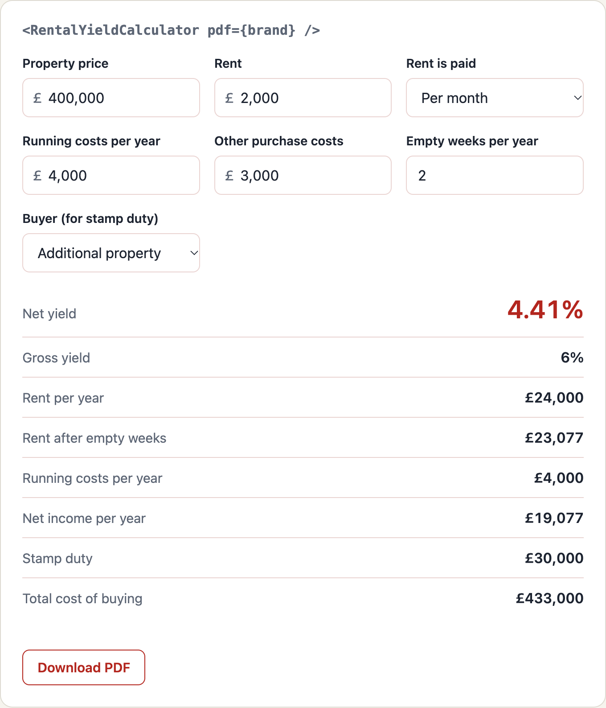<br/><sub><b>Rental yield</b>, gross and net</sub></td>
<td width="50%" valign="top">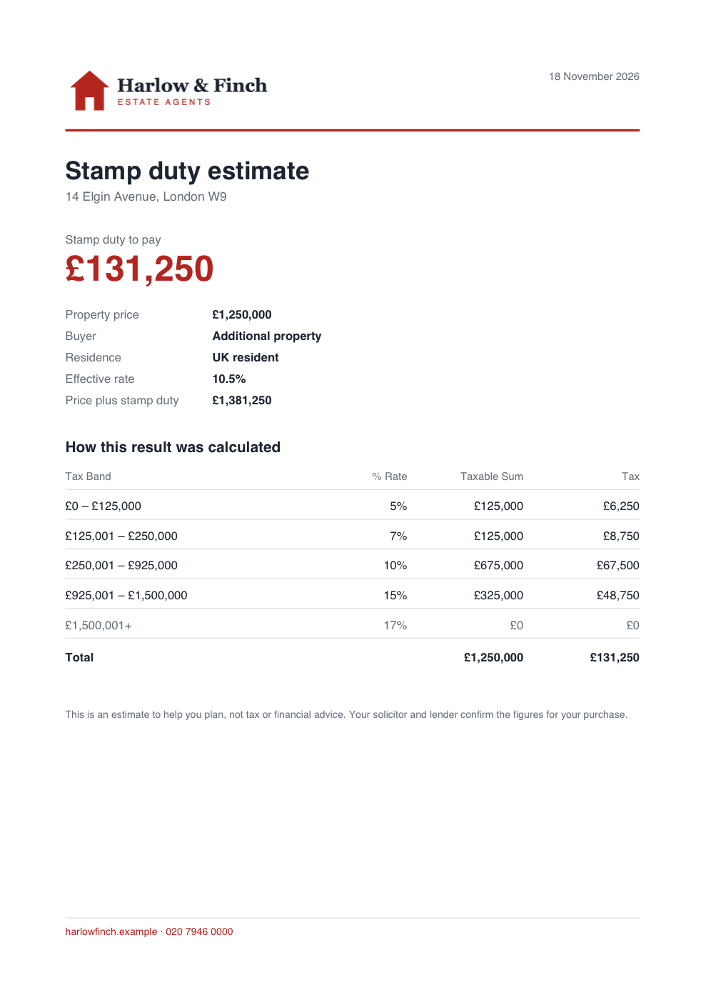<br/><sub><b>Any of them as a PDF</b> in your brand</sub></td>
</tr>
</table>

- **Headless core.** Works with React, Vue, Svelte, a server template, a CLI or a spreadsheet export.
- **Zero dependencies.** About 20 kB minified and gzipped for every calculator, 7 kB for stamp duty alone; PDFs are a separate 8 kB that loads only when used. React is only needed if you use the components.
- **Runs anywhere.** Node 18+, browsers, edge runtimes, React Native. ESM and CommonJS, fully typed.
- **Plain JSON out.** Stamp duty and mortgage results cross an API or a server-to-client boundary untouched.
- **Deterministic.** No `Intl`, no locale lookups: the server and the browser always print the same string.

> [!IMPORTANT]
> Results are estimates, not tax or financial advice. "Stamp duty" here is SDLT, which applies in
> **England and Northern Ireland**. Scotland (LBTT) and Wales (LTT) have their own taxes: use
> [`calculatePropertyTax`](#scotland-and-wales) for those. See [what it doesn't cover](#what-it-doesnt-cover).

## See it running

The repo includes a small Next.js app with two pages: the ready-made components with a theme
switcher, and the same calculators hand-built from the library's data.

```sh
pnpm install
pnpm demo          # http://localhost:3000
```

<table>
<tr>
<td width="50%" valign="top">
<picture>
  <source media="(prefers-color-scheme: dark)" srcset="assets/demo-stamp-duty-dark.png">
  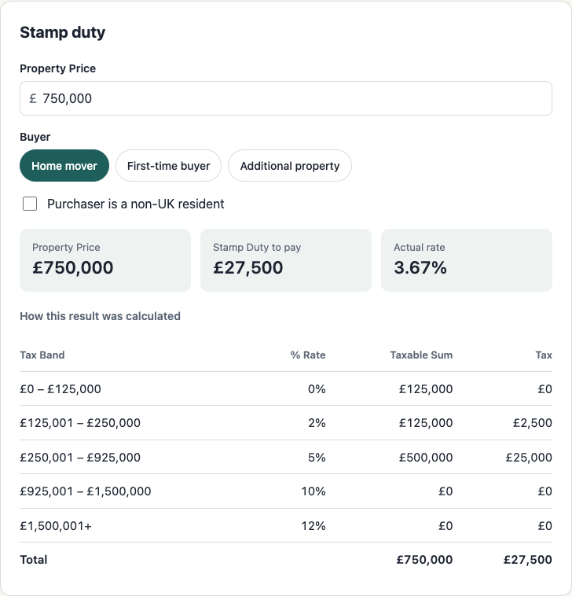
</picture>
</td>
<td width="50%" valign="top">
<picture>
  <source media="(prefers-color-scheme: dark)" srcset="assets/demo-mortgage-dark.png">
  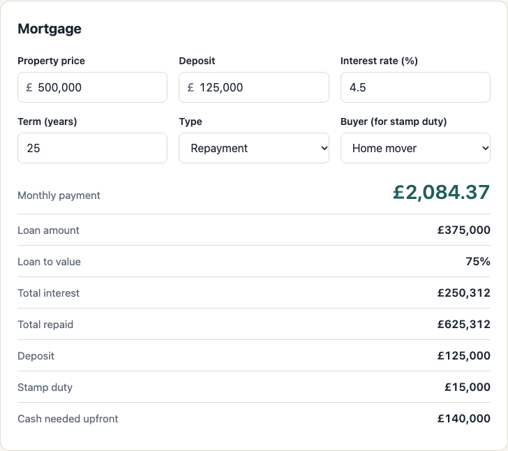
</picture>
<br/><br/>
<picture>
  <source media="(prefers-color-scheme: dark)" srcset="assets/demo-calculator-dark.png">
  
</picture>
</td>
</tr>
</table>

Each of those is around a hundred lines of JSX with no maths in it. Read them in
[`demo/app/components`](demo/app/components).

## Install

```sh
npm install property-calculators
```

```ts
import { calculateStampDuty, getMortgageSummary } from 'property-calculators';
import { createCalculator, CALCULATOR_LAYOUT } from 'property-calculators/calculator';
```

| Entry point | Contains |
| --- | --- |
| `property-calculators` | Stamp duty, mortgage and rental yield, plus the desk calculator under the `calculator` namespace |
| `property-calculators/stamp-duty` | Stamp duty only |
| `property-calculators/mortgage` | Mortgage only |
| `property-calculators/rental-yield` | Rental yield only |
| `property-calculators/calculator` | Desk calculator only |
| `property-calculators/pdf` | Branded PDF output for every calculator |
| `property-calculators/react` | Ready-made React components (needs React 18 or later) |
| `property-calculators/styles.css` | The components' default stylesheet, for when you'd rather load it yourself |

---

## React components

Thirteen components, one import, no CSS file to load and nothing to configure. The four below,
plus `PropertyTaxCalculator`, `CompanyStampDutyCalculator`, `AffordabilityCalculator`,
`OverpaymentCalculator`, `RemortgageCalculator`, `BuyingCostsCalculator`, `BuyToLetCalculator`,
`PricePerAreaCalculator` and `TenantDepositCalculator`. Each takes `default*` props for its
fields, `pdf` and `onChange`.

```tsx
import {
    DeskCalculator,
    MortgageCalculator,
    RentalYieldCalculator,
    StampDutyCalculator,
} from 'property-calculators/react';

<StampDutyCalculator defaultPrice={750_000} />
<MortgageCalculator defaultPrice={500_000} />
<RentalYieldCalculator defaultPrice={400_000} defaultRent={2_000} />
<DeskCalculator rates={[{ currency: 'EUR', value: 0.86 }, { currency: 'USD', value: 0.79 }]} />
```

They are accessible (every control is labelled, results are announced, the keypad has spoken
names), responsive down to phone width, and work with server rendering and the Next.js App Router.

<table>
<tr>
<td width="33%" valign="top"><br/><sub><b>Default</b>: no props</sub></td>
<td width="33%" valign="top">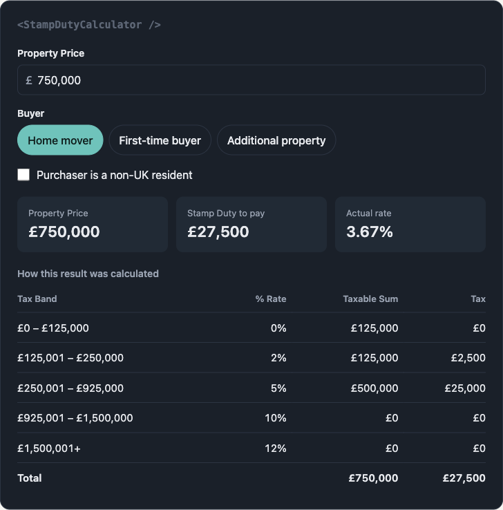<br/><sub><b>Dark</b>: <code>theme="dark"</code></sub></td>
<td width="33%" valign="top">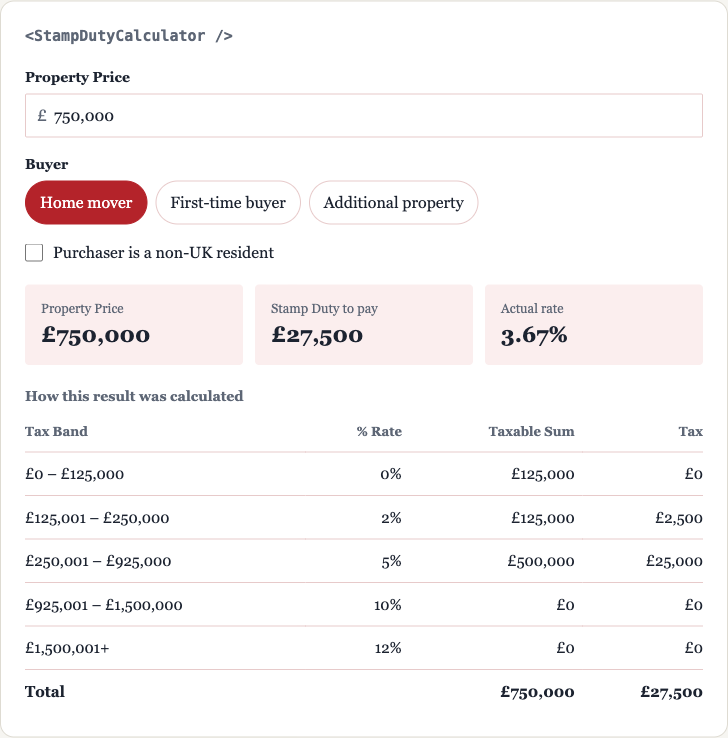<br/><sub><b>Yours</b>: five CSS variables</sub></td>
</tr>
</table>

The other components, as they look with no props beyond a starting price:

<table>
<tr>
<td width="33%" valign="top"><br/><sub><b>MortgageCalculator</b></sub></td>
<td width="33%" valign="top"><br/><sub><b>RentalYieldCalculator</b></sub></td>
<td width="33%" valign="top">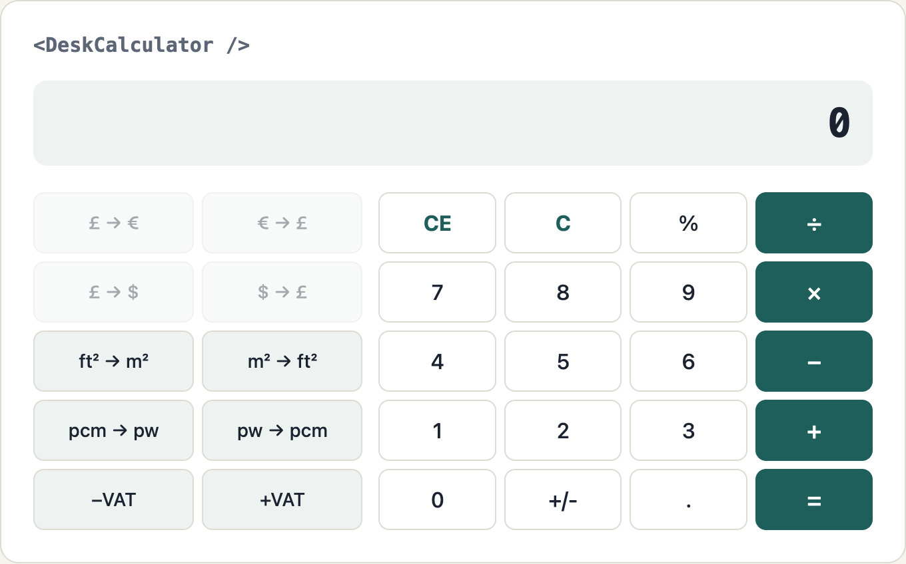<br/><sub><b>DeskCalculator</b></sub></td>
</tr>
</table>

<sub>The mortgage and rental yield shots use a red <code>--pc-accent</code> and the optional <a href="#branded-pdfs">Download PDF</a> button.</sub>

### Make them yours

Pick whichever of these fits how you already style things. They combine.

**1. CSS variables**, for matching a brand in a minute. Set them on the component or any ancestor:

```tsx
<StampDutyCalculator
    style={{
        '--pc-accent': '#b4232a',
        '--pc-soft': '#fbeeee',
        '--pc-line': '#e7caca',
        '--pc-radius': '2px',
        '--pc-font': 'Georgia, serif',
    }}
/>
```

| Variable | Controls | Default |
| --- | --- | --- |
| `--pc-accent` | Selected options, operator keys, the headline figure | `#1f5f5b` |
| `--pc-accent-ink` | Text on the accent colour | `#ffffff` |
| `--pc-ink` | Main text | `#1c2330` |
| `--pc-muted` | Labels and secondary text | `#5d6675` |
| `--pc-surface` | Inputs and keys | `#ffffff` |
| `--pc-soft` | Result tiles, the display, conversion keys | `#eef3f2` |
| `--pc-line` | Borders and dividers | `#dedbd2` |
| `--pc-radius` | Corner radius | `8px` |
| `--pc-gap` | Spacing between fields | `16px` |
| `--pc-font`, `--pc-mono` | Typefaces | system fonts |

**2. Themes.** `theme="dark"`, or `theme="auto"` to follow the visitor's system setting.

**3. Your own classes per part**, which is the natural fit for Tailwind. They are added after the
built-in class:

```tsx
<MortgageCalculator
    className="rounded-xl p-6 shadow"
    classNames={{ input: 'rounded-none border-black', row: 'py-3', hint: 'text-red-600' }}
/>
```

Parts: `root`, `form`, `field`, `label`, `money`, `prefix`, `input`, `select`, `options`,
`option`, `check`, `summary`, `summaryItem`, `heading`, `table`, `rows`, `row`, `hint`,
`display`, `pads`, `pad`, `key`.

**4. Start from nothing.** `unstyled` drops the default styles for that component. Every element
keeps a stable `pc-*` class (`pc-input`, `pc-key`, `pc-summary-item`, ...) and useful data
attributes (`data-variant` on keys, `data-checked` on options, `data-lead` on the headline row),
so you can write the CSS from scratch.

```tsx
<DeskCalculator unstyled className="my-calculator" />
```

The default rules are written so that none of them outrank a single class of yours: you never
need `!important` to override one.

### Props

All of them accept `className`, `classNames`, `theme`, `unstyled`, `inlineStyles`, and any ordinary
`div` attribute (`id`, `style`, `data-*`), which lands on the root element.

| Component | Props |
| --- | --- |
| `StampDutyCalculator` | `defaultPrice`, `defaultBuyer`, `defaultNonUkResident`, `showBreakdown` (default `true`), `pdf`, `onChange(estimate \| null)` |
| `MortgageCalculator` | `defaultPrice`, `defaultDeposit` (default 25% of the price), `defaultRate`, `defaultTermYears`, `defaultType`, `defaultBuyer`, `pdf`, `onChange(summary \| null)` |
| `RentalYieldCalculator` | `defaultPrice`, `defaultRent`, `defaultRentPeriod` (default `"month"`), `defaultAnnualCosts`, `defaultPurchaseCosts`, `defaultVoidWeeks`, `defaultBuyer` (default `"additional-property"`), `pdf`, `onChange(summary \| null)` |
| `DeskCalculator` | `rates`, `keyboard` (default `true`), `conversions` (default `true`), `calculator` (your own store from `createCalculator()`) |

`pdf` adds a download button: `true` for a plain page, or [your brand](#branded-pdfs).

`onChange` hands you the same objects the headless functions return, so you can react to a result
elsewhere on the page:

```tsx
<StampDutyCalculator onChange={(estimate) => setStampDuty(estimate?.stampDuty ?? null)} />
```

> [!NOTE]
> The styles travel inside the components as a `<style>` tag. If your site's Content Security
> Policy blocks inline styles, import `property-calculators/styles.css` yourself and pass
> `inlineStyles={false}`.

When the components don't bend far enough, drop down a level: everything below is what they are
built from.

---

## Branded PDFs

Every calculator can hand its answer over as a PDF in your colours, with your logo on it. It is
the same page whichever calculator made it, so a stamp duty estimate, a mortgage and a rental
yield from your site all look like they came from the same company.

Each component on the left, and the PDF its button downloads on the right:

<table>
<tr>
<td width="50%" valign="top">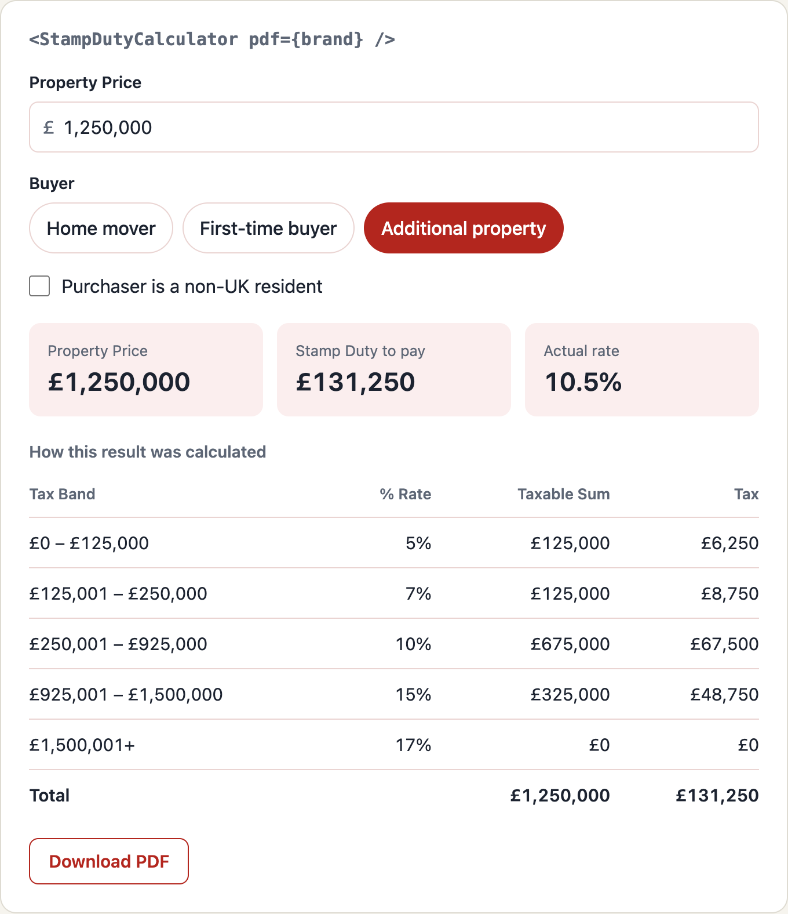<br/><sub><b>StampDutyCalculator</b> with <code>pdf={brand}</code></sub></td>
<td width="50%" valign="top"><br/><sub><b>Its PDF</b>: logo, colour, address, footer</sub></td>
</tr>
<tr>
<td width="50%" valign="top"><br/><sub><b>MortgageCalculator</b> with <code>pdf={brand}</code></sub></td>
<td width="50%" valign="top">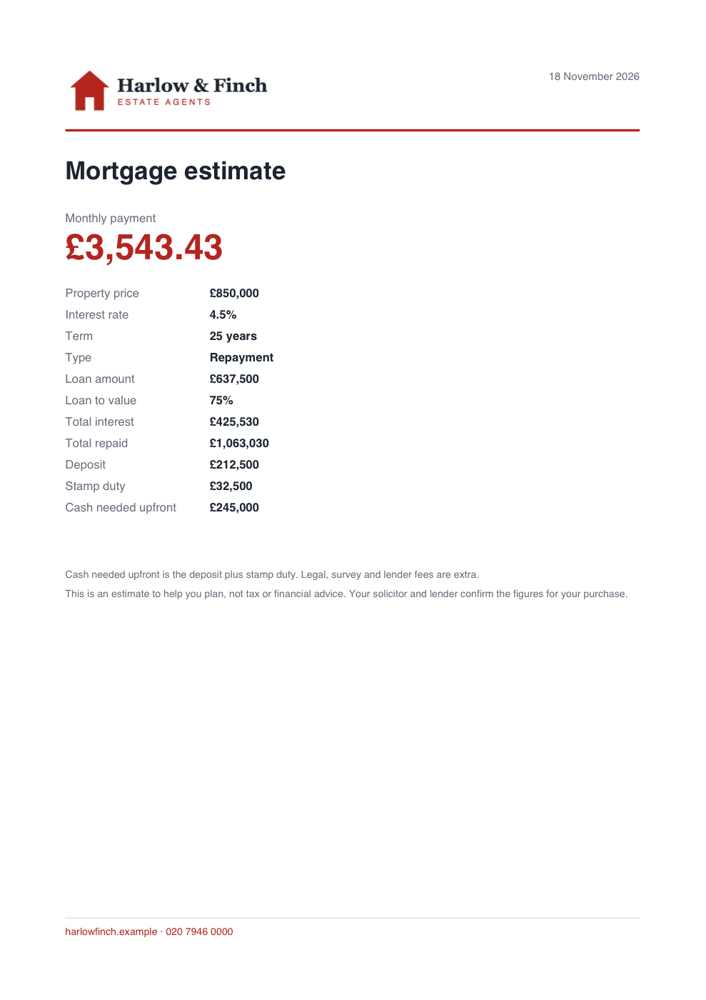<br/><sub><b>Its PDF</b>, in the same brand</sub></td>
</tr>
<tr>
<td width="50%" valign="top"><br/><sub><b>RentalYieldCalculator</b> with <code>pdf={brand}</code></sub></td>
<td width="50%" valign="top">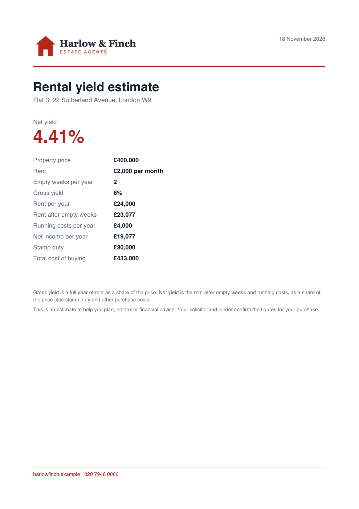<br/><sub><b>Its PDF</b>, in the same brand</sub></td>
</tr>
<tr>
<td width="50%" valign="top">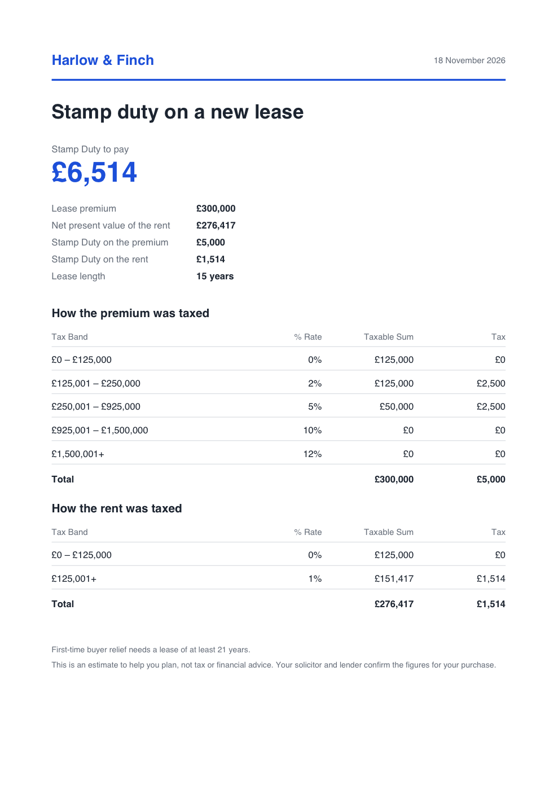<br/><sub><b>New lease</b>: a name and colour, no logo (<code>leaseStampDutyPdf</code>)</sub></td>
<td width="50%" valign="top">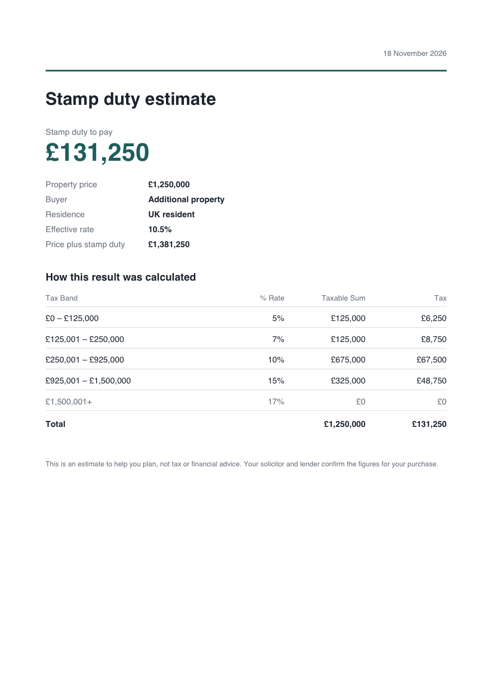<br/><sub><b>Plain</b>: no options at all</sub></td>
</tr>
</table>

### With the React components

Add `pdf` and a "Download PDF" button appears under the result. It prints what the visitor is
looking at: the price they typed, the buyer type they chose, the figures on screen.

```tsx
import { MortgageCalculator, RentalYieldCalculator, StampDutyCalculator } from 'property-calculators/react';

const brand = {
    name: 'Harlow & Finch',                 // header when there's no logo, and the document's author
    colour: '#b3261e',                      // the rule under the header and the headline figure
    logo: '/logo.png',                      // a JPEG or PNG; transparency is kept
    footer: 'harlowfinch.example · 020 7946 0000',
};

<StampDutyCalculator defaultPrice={750_000} pdf={brand} />
<MortgageCalculator defaultPrice={500_000} pdf={brand} />
<RentalYieldCalculator defaultPrice={400_000} defaultRent={2_000} pdf={brand} />

<StampDutyCalculator pdf />                 // plain, unbranded
```

The brand object also takes `label` (the button's text), `filename`, `subtitle` (a line under the
title, such as the property's address), `notice` (your own small print, or `false` for none) and
`date` (`false` to leave it off).

### Without React

One function per calculator. Each takes the result you already have and returns the file's bytes.

```ts
import { calculateStampDuty } from 'property-calculators';
import { downloadPdf, mortgagePdf, rentalYieldPdf, stampDutyPdf } from 'property-calculators/pdf';

const estimate = calculateStampDuty({ price: 1_250_000, buyer: 'additional-property' });

const pdf = await stampDutyPdf(estimate, {
    name: 'Harlow & Finch',
    colour: '#b3261e',
    logo: '/logo.png',
    subtitle: '14 Elgin Avenue, London W9',
    footer: 'harlowfinch.example · 020 7946 0000',
});

downloadPdf(pdf, 'stamp-duty.pdf');        // in a browser: saves the file
```

On a server, send the same bytes. Nothing here needs a browser:

```ts
// app/api/stamp-duty/[price]/pdf/route.ts
export async function GET(_: Request, { params }: { params: Promise<{ price: string }> }) {
    const estimate = calculateStampDuty({ price: Number((await params).price) });
    const pdf = await stampDutyPdf(estimate, { name: 'Harlow & Finch', colour: '#b3261e' });

    return new Response(pdf, { headers: { 'content-type': 'application/pdf' } });
}
```

`logo` can be a URL (a `data:` URL included), a `File` or `Blob` from an upload field, or raw
bytes. To let a customer attach their own, pass the file straight through:

```tsx
<input type="file" accept="image/png,image/jpeg" onChange={(e) => setLogo(e.target.files?.[0])} />
<StampDutyCalculator pdf={{ name, colour, logo }} />
```

Printing many documents with one logo? Prepare it once with `pdfImage` and reuse the result:

```ts
const logo = await pdfImage('/logo.png');
const files = await Promise.all(estimates.map((estimate) => stampDutyPdf(estimate, { logo })));
```

### A calculator of your own

The page layout is not tied to these calculators. Describe any result as a headline, some facts
and optional tables, and `createPdf` prints it in the same brand:

```ts
import { createPdf } from 'property-calculators/pdf';

const pdf = await createPdf(
    {
        title: 'Service charge estimate',
        headline: { label: 'Per year', value: '£4,820' },
        facts: [
            { label: 'Flat', value: '2 bedrooms, 3rd floor' },
            { label: 'Ground rent', value: '£250' },
        ],
        tables: [{ title: 'Breakdown', columns: ['Item', 'Cost'], rows: [['Lift', '£900'], ['Insurance', '£1,200']] }],
    },
    brand,
);
```

`stampDutyReport`, `mortgageReport`, `rentalYieldReport` and `leaseStampDutyReport` give you the
built-in reports as that same data, if you want to add a row before printing.

### How it works

A PDF is a text file: numbered objects, then an index saying where each one starts. This library
writes that file by hand, which is why the feature adds no dependency.

- **No font is embedded.** Every PDF reader ships with Helvetica, so the file only names it. Text
  is measured with Helvetica's published widths, which is how figures line up on the right.
- **A JPEG logo goes in untouched.** PDF stores JPEG natively.
- **A PNG logo is unpacked** into colour and transparency using the `DecompressionStream` built
  into browsers and Node 18+. That is the only reason the functions are `async`.
- **It is small and loads late.** About 7 kB gzipped, in its own entry point. The React components
  fetch it on the first click of the button, so a visitor who never downloads a PDF never pays for it.
- **The files are small.** A plain estimate is about 4 kB; a logo adds roughly its own size.

Limits worth knowing: one A4 page, Western European characters (anything else prints as `?`),
and logos must be JPEG or 8-bit non-interlaced PNG, which is what design tools export by default.

---

## Stamp duty

### One call

```ts
import { calculateStampDuty } from 'property-calculators';

const estimate = calculateStampDuty({
    price: 750_000,
    buyer: 'home-mover',   // or 'first-time-buyer' | 'additional-property'
    nonUkResident: false,  // true adds the 2% surcharge
});
```

```jsonc
{
    "price": 750000,
    "buyer": "home-mover",
    "nonUkResident": false,
    "stampDuty": 27500,
    "effectiveRate": 3.6666666666666665,
    "formatted": { "price": "£750,000", "stampDuty": "£27,500", "effectiveRate": "3.67%" },
    "bands": [
        {
            "from": 0, "to": 125000, "rate": 0, "taxable": 125000, "tax": 0,
            "formatted": { "range": "£0 – £125,000", "rate": "0%", "taxable": "£125,000", "tax": "£0" }
        },
        {
            "from": 125000, "to": 250000, "rate": 2, "taxable": 125000, "tax": 2500,
            "formatted": { "range": "£125,001 – £250,000", "rate": "2%", "taxable": "£125,000", "tax": "£2,500" }
        }
        // ... one per band. The open-ended top band has "to": null.
    ]
}
```

Only `price` is required. A price that is negative or not a finite number throws a `RangeError`.

The same £750,000 home, six ways:

<p align="center">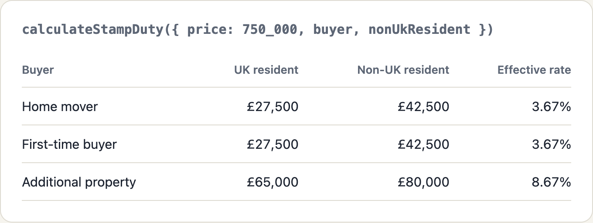<br/><sub>Every figure here is one <code>calculateStampDuty</code> call</sub></p>

Or as a table you can copy:

| Buyer | UK resident | Non-UK resident |
| --- | ---: | ---: |
| Home mover | £27,500 | £42,500 |
| First-time buyer (no relief above £500,000) | £27,500 | £42,500 |
| Additional property | £65,000 | £80,000 |

### From result to interface

`getStampDutyTable` arranges an estimate for display: headline figures, then the breakdown as
columns and rows of strings.

```tsx
import { BUYER_TYPES, calculateStampDuty, getStampDutyTable } from 'property-calculators';

function StampDuty({ price, buyer, onBuyerChange }) {
    const { summary, columns, rows, totals } = getStampDutyTable(calculateStampDuty({ price, buyer }));

    return (
        <>
            <select value={buyer} onChange={(e) => onBuyerChange(e.target.value)}>
                {BUYER_TYPES.map((b) => <option key={b.value} value={b.value}>{b.label}</option>)}
            </select>

            <dl>
                {summary.map((item) => (
                    <div key={item.key}><dt>{item.label}</dt><dd>{item.formatted}</dd></div>
                ))}
            </dl>

            <table>
                <thead>
                    <tr>{columns.map((c) => <th key={c.key}>{c.label}</th>)}</tr>
                </thead>
                <tbody>
                    {rows.map((row) => (
                        <tr key={row.key}>{columns.map((c) => <td key={c.key}>{row[c.key]}</td>)}</tr>
                    ))}
                </tbody>
                <tfoot>
                    <tr>{columns.map((c) => <td key={c.key}>{totals[c.key]}</td>)}</tr>
                </tfoot>
            </table>
        </>
    );
}
```

That is the whole component. Swap the tags for your own design system's.

<p align="center"><br/><sub><code>summary</code> is the three tiles, <code>columns</code> and <code>rows</code> the table, <code>totals</code> its last line</sub></p>


### Listing pages

Search results and property pages usually want one figure, not a breakdown.

```ts
import { getStaticStampDuty, stampDutyByPrice, stampDutyFor } from 'property-calculators';

stampDutyFor(895_000);                 // 34750
stampDutyFor(null);                    // null  (no price, nothing to show)

stampDutyByPrice([650_000, 895_000, null]);
// { 650000: 22500, 895000: 34750 }    one lookup for a whole page of cards

getStaticStampDuty(1_250_000);         // "Stamp Duty £68,750"
getStaticStampDuty(1_250_000, 1);      // null  (qualifier 1 = price on application)
```

<p align="center">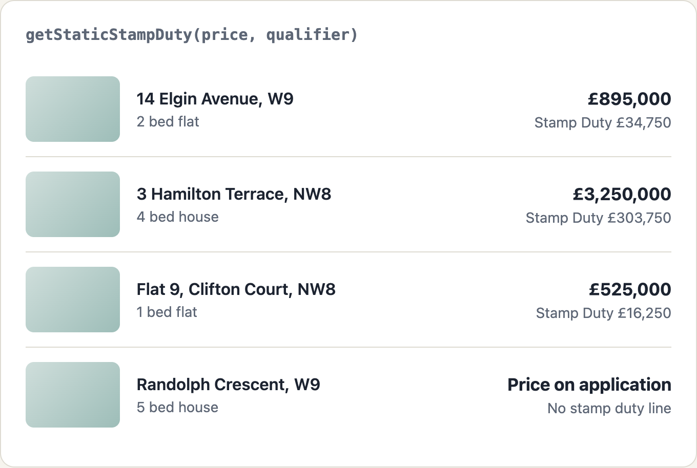<br/><sub><code>getStaticStampDuty</code> on a results page: one line per card, and nothing for a price on application</sub></p>

### Form state

A tiny reducer for a calculator form. It knows that "second home" and "first-time buyer" can't
both be ticked, and clears one when you set the other.

```ts
import { canCalculate, initialState, methods } from 'property-calculators';

let state = methods(initialState).price(750_000);
state = methods(state).secondHome(true);

canCalculate(state);               // true
state = methods(state).calculate();

state.stampDuty;                   // 65000
state.bands;                       // the per-band breakdown
```

It is plain functions, so it drops into `useReducer`, a store, or react-use's
`useMethods(methods, initialState)`. `STAMP_DUTY_FIELDS` describes the three checkboxes (name,
label, which state key each one drives).

<p align="center">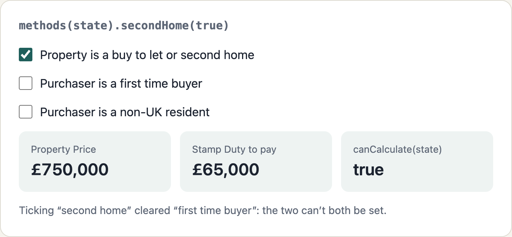<br/><sub>The three checkboxes come from <code>STAMP_DUTY_FIELDS</code>; the state keeps them consistent</sub></p>

### Serving it over HTTP

Two helpers build a response body and a PDF model from a request, so a route is one line.

```ts
import { getStampDutyPdfModel, getStampDutyResponse } from 'property-calculators';

// GET /api/stamp-duty/750000?ukResident=true&firstTimeBuyer=false&secondHome=false
return Response.json(getStampDutyResponse({ ...query, price }));

// GET /api/stamp-duty/pdf/:hash?address=...     hash = base64 JSON of the same fields
const model = getStampDutyPdfModel({ hash, address });
// { address, price, stampDuty, actualRate, bands }: hand it to your PDF library
```

<p align="center">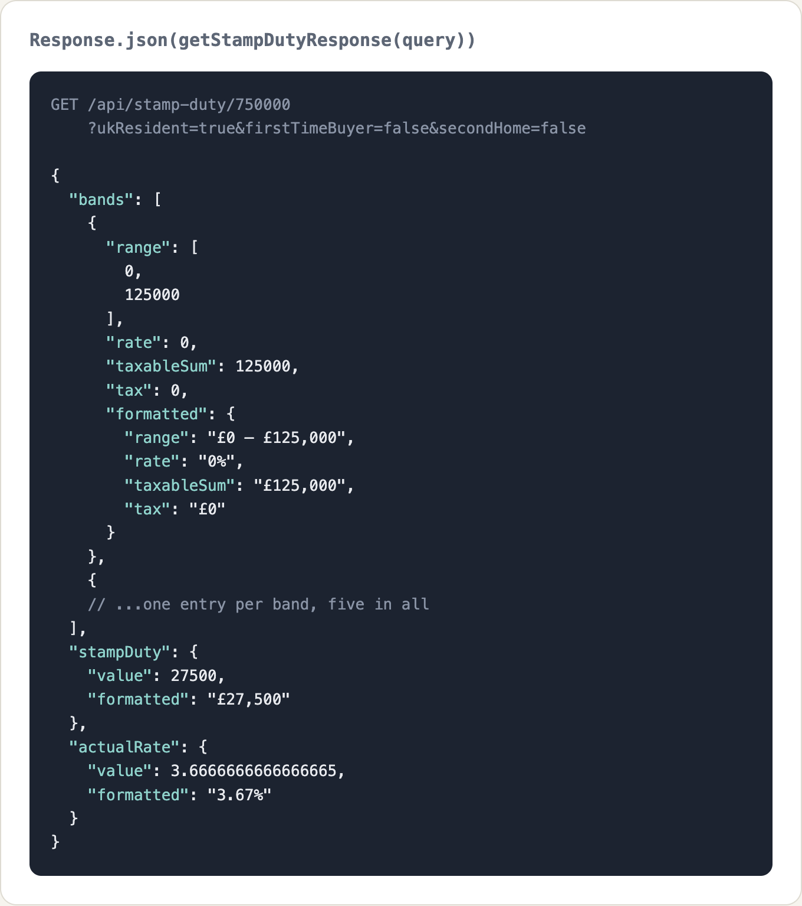<br/><sub>What the route returns</sub></p>

Two things to know about `getStampDutyResponse`:

- A flag is on only when it is exactly `"true"`, and **`ukResident` is off unless you send it**.
  Always send all three flags.
- It does not validate the price: nonsense in gives zeros out, and a negative price throws. Check
  the price before calling it, as the [demo route](demo/app/api/stamp-duty/%5Bprice%5D/route.ts) does.
  For new work, prefer returning `calculateStampDuty(...)`, which validates and has the cleaner shape.

`getStampDutyPdfModel` throws a `TypeError` for a hash that isn't a base64 JSON object.
`encodeStampDutyHash` builds one.

### The rates

Rates in force **from 1 April 2025** (`SDLT_RATES_EFFECTIVE_FROM`). Each rate applies only to the
slice of the price inside its band.

| Slice of the price | Standard | Additional property | First-time buyer¹ |
| --- | ---: | ---: | ---: |
| Up to £125,000 | 0% | 5% | 0% |
| £125,001 to £250,000 | 2% | 7% | 0% |
| £250,001 to £300,000 | 5% | 10% | 0% |
| £300,001 to £500,000 | 5% | 10% | 5% |
| £500,001 to £925,000 | 5% | 10% | — |
| £925,001 to £1.5 million | 10% | 15% | — |
| Above £1.5 million | 12% | 17% | — |

¹ First-time buyer relief applies only to homes of £500,000 or less. Above that, standard rates
apply to the whole price.

- **Non-UK residents** pay 2 percentage points more in every band, on top of any other rate.
- **Under £40,000** nothing is due, and the surcharges don't apply.

The tables themselves are exported as `BAND_TABLES` if you want to render a rates page. Check them
against [GOV.UK's residential rates](https://www.gov.uk/stamp-duty-land-tax/residential-property-rates)
before relying on them after a Budget.

### New leases

Buying a new lease is taxed twice: once on the **premium** (the lump sum, taxed like a purchase
price) and once on the **rent**. The rent is taxed through its *net present value*: every year's
rent, discounted by 3.5% a year back to today, added up over the whole lease.

```ts
import { calculateLeaseStampDuty, getLeaseStampDutyTable } from 'property-calculators';

const lease = calculateLeaseStampDuty({
  premium: 275_000,
  rent: 10_000,       // per year; or up to five numbers for the first five years
  termYears: 99,
});

lease.premium.stampDuty;   // 3750    tax on the premium, with lease.premium.bands
lease.rent.npv;            // 276233  net present value of the rent
lease.rent.tax;            // 1512    1% of the value above £125,000
lease.stampDuty;           // 5262
lease.formatted.stampDuty; // "£5,262"

getLeaseStampDutyTable(lease); // { summary, columns, premium: { rows, totals }, rent: { rows, totals }, notes }
```

<table>
<tr>
<td width="50%" valign="top">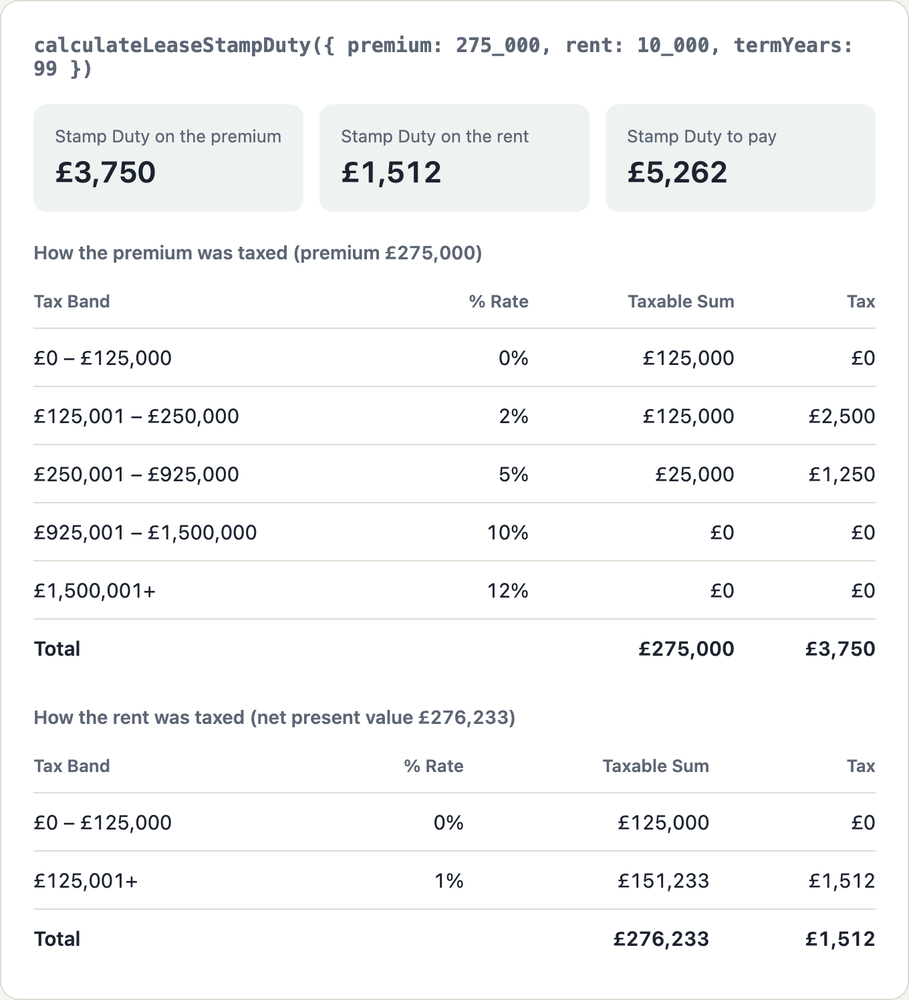<br/><sub><code>getLeaseStampDutyTable(lease)</code>, drawn as it comes</sub></td>
<td width="50%" valign="top"><br/><sub><code>leaseStampDutyPdf(lease, brand)</code></sub></td>
</tr>
</table>

It takes the same `buyer`, `nonUkResident`, `propertyType` and `dwellings` options as
`calculateStampDuty`, and applies the lease rules for you:

| Rule | What happens |
| --- | --- |
| Additional-property surcharge | Charged on the premium only, never on rent. |
| Non-UK resident surcharge | Adds 2 points to the rent bands as well (2% and 3%). Needs a premium of £40,000 or a rent of £1,000 a year. |
| Lease of 7 years or fewer | Neither surcharge applies. |
| First-time buyer relief | Premium only, and only for a lease of 21 years or more. |
| Rent after year five | Uses the highest rent of the first five years. |

When a relief or surcharge you asked for is not applied, `lease.notes` says why in plain English,
and `lease.applied` records what was charged. Need only the rent figure? `calculateRentNpv({ rent, termYears })`.

An existing lease that is sold on is taxed on its price alone: use `calculateStampDuty` for that.

### Non-residential and mixed use

Shops, offices, farmland and mixed property (a flat above a shop) have their own table, with no
reliefs or surcharges.

```ts
calculateStampDuty({ price: 275_000, propertyType: 'non-residential' }).stampDuty; // 3250
```

| Slice of the price | Rate |
| --- | ---: |
| Up to £150,000 | 0% |
| £150,001 to £250,000 | 2% |
| Above £250,000 | 5% |

<p align="center">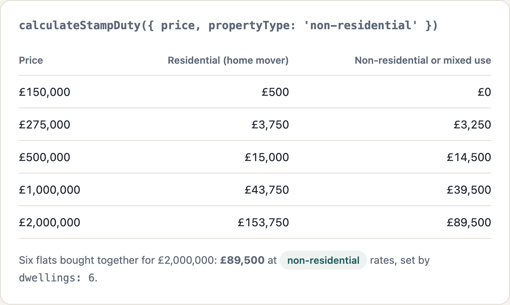<br/><sub>The two tables side by side, and the six-dwellings rule</sub></p>

Two to five dwellings bought in one transaction are charged the additional-property rates.
Six or more dwellings bought in one transaction are taxed at these rates too. Pass `dwellings`
and the switch happens for you; `estimate.propertyType` tells you which table was used.

```ts
calculateStampDuty({ price: 2_000_000, dwellings: 6 }).propertyType; // "non-residential"
```

Rent on a new non-residential lease is charged at 0% up to £150,000 of net present value, 1% to
£5 million and 2% above: `calculateLeaseStampDuty({ ..., propertyType: 'non-residential' })`.

### Replacing a main residence

Someone who already owns a property pays the additional-property rates, unless the purchase
replaces their main home and the old one is already sold. `resolveBuyer` turns the yes/no answers
into the buyer type, with a sentence to show the user. `BUYER_QUESTIONS` has the question wording.

```ts
import { resolveBuyer, getHigherRatesRefund, getRefundDeadlines } from 'property-calculators';

const answer = resolveBuyer({
  ownsOtherProperty: true,
  replacingMainResidence: true,
  previousHomeSold: false,
});

answer.buyer;          // "additional-property"
answer.refundPossible; // true
answer.explanation;    // "Your previous main residence is not sold yet, so the higher rates apply. You can claim…"

calculateStampDuty({ price: 600_000, buyer: answer.buyer }).stampDuty; // 50000
```

If the old home sells within three years, the extra can be claimed back:

```ts
getHigherRatesRefund({ price: 600_000 });
// { paid: 50000, standard: 20000, refund: 30000, formatted: { refund: "£30,000", … } }

getRefundDeadlines({ purchaseDate: '2025-06-10', saleDate: '2026-02-01' });
// { sellBy: "2028-06-10", filingDate: "2025-06-24", claimBy: "2027-01-31", soldInTime: true }
```

<p align="center">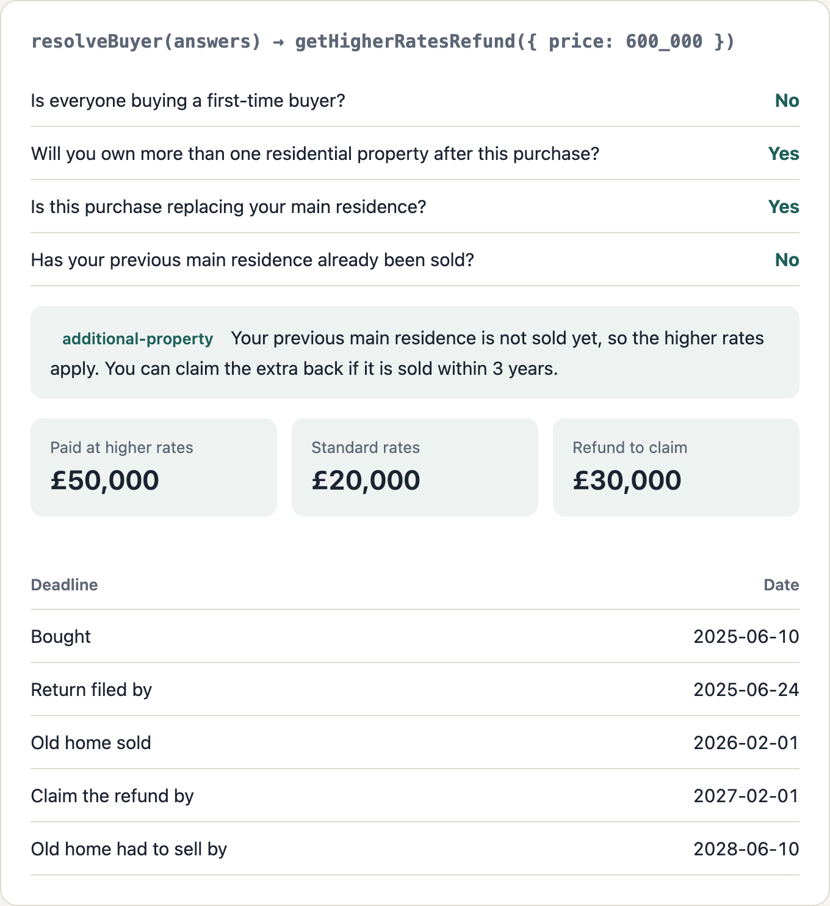<br/><sub>The whole journey: questions from <code>BUYER_QUESTIONS</code>, the outcome from <code>resolveBuyer</code>, the refund and its dates</sub></p>

### Companies

A company buying a home pays differently. Over £500,000 it is a flat 17% of the whole price,
unless a relief applies (a property rental business, a developer and so on). Otherwise it pays the
additional-property rates, even on its first property.

```ts
import { calculateCompanyStampDuty, COMPANY_RELIEFS } from 'property-calculators';

const tax = calculateCompanyStampDuty({ price: 750_000 });

tax.stampDuty;        // 127500
tax.applied.flatRate; // true
tax.notes;            // ["A company buying a dwelling for more than £500,000 pays a flat 17% on the whole price."]

calculateCompanyStampDuty({ price: 750_000, relief: 'property-rental-business' }).stampDuty; // 65000
```

`COMPANY_RELIEFS` lists the seven reliefs with labels for a dropdown. A non-UK resident company
pays 2 points more (19% flat). The result has the same shape as any other estimate, plus
`applied` and `notes`.

### Scotland and Wales

Scotland charges LBTT and Wales charges LTT, each with its own bands. `calculatePropertyTax`
picks the right one from the country, so one form can serve the whole UK.

```ts
import { calculatePropertyTax, COUNTRIES } from 'property-calculators/land-tax';

const tax = calculatePropertyTax({ country: 'scotland', price: 300_000, buyer: 'additional-property' });

tax.tax;               // "LBTT"
tax.bandTax;           // 4600   from the bands
tax.supplement.amount; // 24000  Additional Dwelling Supplement: 8% of the whole price
tax.total;             // 28600
tax.formatted.total;   // "£28,600"
```

The same £350,000 first home costs a different amount in each country:

| Country | Tax | First-time buyer pays |
| --- | --- | ---: |
| England, Northern Ireland | SDLT | £2,500 |
| Scotland | LBTT | £7,750 |
| Wales | LTT | £7,500 |

Where a country has no equivalent of something you asked for, `tax.notes` says so: Wales has no
first-time buyer relief, and neither Scotland nor Wales has a non-UK resident surcharge. The rate
tables are exported as `LBTT_BAND_TABLES` and `LTT_BAND_TABLES`. Leases are SDLT only for now.

### What it doesn't cover

The calculator handles one person or couple buying a home, a new lease, or non-residential
property. It does not model:

- Leases in Scotland or Wales (purchases are [covered](#scotland-and-wales))
- The conditions for each company relief, or a company buying a new lease
- Shared ownership and linked transactions
- Rates before 1 April 2025
- Rent under an assured tenancy, which is excluded from the rent charge from 1 May 2026
- Every exception to the surcharges (trusts, partnerships, separated spouses and so on)

---

## Mortgage

<table>
<tr>
<td width="50%" valign="top"><br/><sub>The ready-made <code>&lt;MortgageCalculator /&gt;</code></sub></td>
<td width="50%" valign="top"><br/><sub>And <a href="#branded-pdfs">its PDF</a></sub></td>
</tr>
</table>

```ts
import { getMortgageSummary } from 'property-calculators/mortgage';

const { summary, error } = getMortgageSummary({
    price: 500_000,
    deposit: 100_000,
    rate: 5,              // annual, percent
    termYears: 25,
    type: 'repayment',    // or 'interest-only'
    buyer: 'home-mover',  // optional: buyer type for the stamp duty
});
```

You get either a `summary` or an `error`, never both. The error is a sentence written for the
form, such as `"Enter an interest rate between 0% and 25%."`

`summary.rows` is the result in display order:

| `label` | `formatted` |
| --- | ---: |
| Monthly payment | £2,338.36 |
| Loan amount | £400,000 |
| Loan to value | 80% |
| Total interest | £301,508 |
| Total repaid | £701,508 |
| Deposit | £100,000 |
| Stamp duty | £15,000 |
| Cash needed upfront | £115,000 |

```tsx
{summary
    ? summary.rows.map((row) => <Row key={row.key} label={row.label} value={row.formatted} />)
    : <FormError>{error}</FormError>}
```

Every figure is also on `summary` as a number (`summary.monthlyPayment`) and in
`summary.formatted` as a string.

**How it's worked out.** Repayment mortgages use the standard annuity formula with monthly
compounding; interest-only pays the interest each month and the loan at the end. One rate is
assumed for the whole term. "Cash needed upfront" is the deposit plus stamp duty; legal fees,
surveys and lender fees are extra.

Helpers for the form: `REPAYMENT_TYPES` (select options), `MORTGAGE_DEFAULTS`, `MORTGAGE_LIMITS`
(min and max for rate and term), `depositFromPercent(price, 10)` and `depositPercentOf(price, deposit)`
for a pounds-or-percent deposit field, and `calculateMortgage` if you only want the maths.

---

## Affordability

A first answer to "how much can I borrow?", from income multiples. An illustration, not a
lender's decision.

```ts
import { getAffordabilitySummary, calculateIncomeNeeded } from 'property-calculators/affordability';

const { summary, error } = getAffordabilitySummary({
  income: 45_000,
  secondIncome: 30_000,
  monthlyCommitments: 400, // loans and credit cards
  deposit: 50_000,
  rate: 4.5,
  termYears: 30,
});

summary.formatted.maxLoan;         // "£315,900"   4.5 times income after commitments
summary.formatted.maxPrice;        // "£365,900"
summary.formatted.monthlyPayment;  // "£1,600.62"
summary.formatted.stressedPayment; // "£2,208.82"  if rates rose 3 points
summary.formatted.cashUpfront;     // "£58,295"    deposit plus stamp duty
summary.rows;                      // every figure, labelled, in display order
```

The multiple (default 4.5) and the stress buffer (default 3 points) are yours to set. Going the
other way, `calculateIncomeNeeded({ price: 365_900, deposit: 50_000, monthlyCommitments: 400 })`
gives the income a price needs: `£75,000`.

## Overpayments and remortgaging

What paying extra does to a repayment mortgage:

```ts
import { getOverpaymentSummary, getRemortgageSummary } from 'property-calculators/overpayment';

const { summary } = getOverpaymentSummary({
  balance: 200_000,
  rate: 5,
  termYears: 25,
  monthlyOverpayment: 200,
  lumpSum: 10_000,
});

summary.formatted.interestSaved; // "£56,501"
summary.formatted.monthsSaved;   // "7 years 8 months"
summary.formatted.monthsAfter;   // "17 years 4 months"
```

Pass `includeSchedule: true` for year-by-year balances, with and without the overpayment, ready
for a chart.

And whether a new deal is worth its fees:

```ts
const { summary } = getRemortgageSummary({
  balance: 200_000,
  currentRate: 5.5,
  newRate: 4.5,
  termYears: 25,
  productFee: 999,
  earlyRepaymentCharge: 1_000,
});

summary.formatted.monthlySaving;   // "£116.51"
summary.formatted.switchingCost;   // "£1,999"
summary.formatted.breakEvenMonths; // "1 year 1 month"
summary.formatted.paymentSaving;   // "£797.24"   payments saved over 2 years, less the costs
summary.formatted.netSaving;       // "£1,978.20" including the £1,180.96 less owed at the end
```

Break-even counts the interest saved, not just the lower payment, so a fee added to the loan
(`feePayment: 'add-to-loan'`) is still counted in full. It reads `"Never"` when the switch doesn't
pay for itself.

## Cost of buying

Everything a buyer needs in the bank on completion day, item by item.

```ts
import { getBuyingCostsSummary } from 'property-calculators/buying-costs';

const { summary } = getBuyingCostsSummary({
  price: 300_000,
  deposit: 30_000,
  legalFees: 1_500,
  survey: 500,
  removals: 800,
});

summary.formatted.cashUpfront; // "£37,800"
summary.formatted.stampDuty;   // "£5,000"   worked out for you
summary.items;                 // Deposit £30,000 (79.37%), Stamp duty £5,000 (13.23%), Legal fees £1,500 (3.97%)…
```

Fees default to £0: the package doesn't guess what a solicitor charges. `extras` takes any other
costs as `{ label, amount }`.

## Buy-to-let check

Lenders size a buy-to-let loan by whether the rent covers the interest at a stressed rate.

```ts
import { getBuyToLetSummary } from 'property-calculators/buy-to-let';

const { summary } = getBuyToLetSummary({
  rent: 1_200,
  price: 250_000,
  deposit: 62_500,
  borrower: 'higher-rate',
});

summary.verdict;              // "Falls short"
summary.formatted.coverRatio; // "139.63%"   145% required
summary.formatted.maxLoan;    // "£180,564"  the most this rent supports
summary.formatted.minRent;    // "£1,246.10" the rent this loan needs
```

The defaults are market conventions, not law: a 5.5% stress rate (the Bank of England's minimum
for most loans) and cover of 125% for basic-rate taxpayers and companies, 145% for higher-rate
taxpayers. Every lender differs, so `stressRate` and `coverRatio` can be set directly.

## Rental yield

For a buy-to-let: what the rent returns on what the property really costs.

<table>
<tr>
<td width="50%" valign="top"><br/><sub>The ready-made <code>&lt;RentalYieldCalculator /&gt;</code></sub></td>
<td width="50%" valign="top"><br/><sub>And <a href="#branded-pdfs">its PDF</a></sub></td>
</tr>
</table>

```ts
import { getRentalYieldSummary } from 'property-calculators/rental-yield';

const { summary, error } = getRentalYieldSummary({
    price: 400_000,
    rent: 2_000,
    rentPeriod: 'month',        // or 'week' | 'year'
    voidWeeks: 2,               // weeks a year it stands empty
    annualCosts: 4_000,         // letting fees, insurance, repairs, service charge
    purchaseCosts: 3_000,       // legal fees, survey, refurbishment
});

summary.formatted.grossYield;   // "6%"       a full year's rent ÷ the price
summary.formatted.netYield;     // "4.41%"    rent after voids and costs ÷ everything you paid
summary.formatted.stampDuty;    // "£30,000"  worked out for you
summary.rows;                   // every figure as { key, label, value, formatted }, net yield first
```

Two things it does that a back-of-envelope sum usually misses:

- **Stamp duty is in the cost.** It is charged at additional-property rates unless you say
  otherwise (`buyer`, `nonUkResident`), because a landlord nearly always pays the surcharge. On
  the £400,000 flat above that is £30,000, and it takes most of a point off the yield.
- **Gross and net are kept apart.** Gross yield is the figure agents quote, so it ignores empty
  weeks and costs. Net yield is rent actually received, less running costs, over the price plus
  stamp duty plus the other costs of buying.

A whole portfolio is one more call. Rents and costs are added up before dividing, so a large
property counts for more than a small one:

```ts
import { getPortfolioYield } from 'property-calculators/rental-yield';

getPortfolioYield([
    { price: 400_000, rent: 2_000 },
    { price: 250_000, rent: 1_450 },
])?.formatted;                  // { grossYield: "6.37%", netYield: "5.96%", annualRent: "£41,400", ... }
```

<p align="center">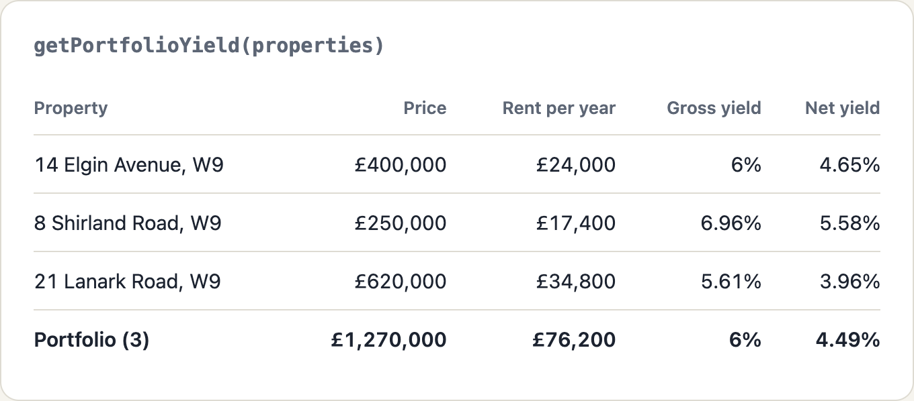<br/><sub><code>getPortfolioYield</code>: the last row is the portfolio, weighted by value</sub></p>

`rentalYieldInputError` gives the reason an input can't be calculated, `calculateRentalYield` the
maths alone, and `RENT_PERIODS` the options for a select.

---

## Price per square foot

The figure that makes two listings comparable.

```ts
import { getPricePerAreaSummary, pricePerAreaFor, comparePricePerArea } from 'property-calculators/price-per-area';

const listing = { amount: 1_000_000, area: 800, areaUnit: 'sqft' } as const;

getPricePerAreaSummary(listing).summary.formatted;
// { perSqFt: "£1,250 per sq ft", perSqM: "£13,455 per sq m", areaSqM: "74.32 sq m", … }

pricePerAreaFor(500_000, 100, 'sqm'); // 464.52: the number alone, or null, for a listing card

comparePricePerArea(listing, { perArea: 1_150, unit: 'sqft' }).formatted.sentence;
// "8.7% above the comparable average"
```

Add `rentPeriod` (`'week'`, `'month'` or `'year'`) and the amount is treated as rent, giving rent
per square foot per year.

## Tenant deposit caps

The most a landlord or agent in England may take, under the Tenant Fees Act 2019.

```ts
import { getTenantDepositSummary, checkTenantDeposit } from 'property-calculators/tenant-deposit';

const { summary } = getTenantDepositSummary({ rent: 1_200 }); // per month by default

summary.formatted.maxTenancyDeposit; // "£1,384.61"  five weeks' rent
summary.formatted.maxHoldingDeposit; // "£276.92"    one week's rent
summary.formatted.maxRentInAdvance;  // "£1,200.00"  one month

checkTenantDeposit({ rent: 1_200 }, 1_500).formatted.sentence;
// "£1,500.00 is £115.39 over the £1,384.61 cap"
```

The cap is five weeks' rent, or six when the rent is £50,000 a year or more. Maximums are rounded
down to the penny, because anything over the cap is a prohibited payment. Rents above £100,000 a
year are outside the Act and return an error. Wales, Scotland and Northern Ireland have different
rules and are not covered.

## Desk calculator

A pocket calculator with the conversions property people reach for all day:

<p align="center"><br/><sub>The ready-made <code>&lt;DeskCalculator /&gt;</code>; every button is data from <code>CALCULATOR_LAYOUT</code></sub></p>

| Button | Does | Example |
| --- | --- | --- |
| `+VAT` / `−VAT` | Adds or removes 20% VAT | 1,200,000 → 1,440,000 |
| `pw → pcm` / `pcm → pw` | Weekly rent to monthly and back | 2,500 pw → 10,833 pcm |
| `ft² → m²` / `m² → ft²` | Floor area | 850 ft² → 78.97 m² |
| `£ → €`, `£ → $` and back | Currency, at rates you supply | |
| `k`, `m` keys | Thousands and millions | `1.2m` → 1,200,000 |

The library holds the state and describes the buttons. You draw them.

```tsx
import { CALCULATOR_LAYOUT, createCalculator } from 'property-calculators/calculator';
import { useState, useSyncExternalStore } from 'react';

function Calculator() {
    const [calculator] = useState(() => createCalculator());
    useSyncExternalStore(calculator.subscribe, calculator.getState, calculator.getState);

    return (
        <>
            <output>{calculator.getDisplay()}</output>

            {[CALCULATOR_LAYOUT.extra, CALCULATOR_LAYOUT.basic].map((group) => (
                <div key={group.columns} style={{ display: 'grid', gridTemplateColumns: `repeat(${group.columns}, 1fr)` }}>
                    {group.buttons.map((button) => (
                        <button
                            key={button.id}
                            aria-label={button.ariaLabel}
                            data-variant={button.variant}
                            disabled={button.requiresRates && !calculator.hasRates()}
                            onClick={() => calculator.input(button.value)}
                        >
                            {button.label}
                        </button>
                    ))}
                </div>
            ))}
        </>
    );
}
```

Each button carries an `id`, a `label` (`"ft² → m²"`), an `ariaLabel` (`"Square feet to square
metres"`), a `variant` to style by (`digit`, `operator`, `clear`, `function`) and a `value` to
pass back on click. Conversions also have `from` and `to` so you can style the two sides of the arrow.

**Keyboard.** `press` takes a key and tells you whether the calculator used it:

```ts
window.addEventListener('keydown', (event) => {
    if (calculator.press(event.key)) event.preventDefault();
});
```

Digits, `+ - * /`, `Enter` or `=`, `%`, `.`, `Backspace`, `k` and `m` are handled. `CALCULATOR_KEYS`
lists them for a shortcuts hint.

**Exchange rates.** The library doesn't fetch anything. Give it rates from wherever you get them;
each `value` is what one unit of the currency is worth in pounds. Until you do, the currency
buttons do nothing, and `requiresRates` lets you disable them.

```ts
calculator.setRates([
    { currency: 'EUR', value: 0.86 },
    { currency: 'USD', value: 0.79 },
]);
```

**Not using React?** `createCalculator()` is a plain store: `getState`, `getDisplay`, `input`,
`press`, `setRates`, `subscribe`. If you'd rather own the state, `reducer`, `bindActions` and
`getInitialState` plug into any reducer setup, and `constructExpression(expression, input, meta)`
is the pure function underneath it all.

> [!NOTE]
> Button values are JavaScript symbols, so calculator state can't be serialised to JSON or sent
> between a server and a client. Create the calculator in the browser. Very large results are
> shown in scientific notation (`4.3e+25`).

---

## Recipes

<details>
<summary><b>Next.js server component</b>: stamp duty on a listing page, no client JavaScript</summary>

```tsx
import { calculateStampDuty, getStampDutyTable } from 'property-calculators';

export default async function Listing({ params }) {
    const listing = await getListing((await params).id);
    const { summary } = getStampDutyTable(calculateStampDuty({ price: listing.price }));

    return (
        <aside>
            {summary.map((item) => (
                <p key={item.key}>{item.label}: <strong>{item.formatted}</strong></p>
            ))}
        </aside>
    );
}
```

</details>

<details>
<summary><b>API route</b>: a validated JSON endpoint</summary>

```ts
import { calculateStampDuty, isBuyerType, parsePriceParam } from 'property-calculators';

export function GET(request: Request) {
    const params = new URL(request.url).searchParams;
    const price = parsePriceParam(params.get('price'));
    const buyer = params.get('buyer') ?? 'home-mover';

    if (price === null || !isBuyerType(buyer))
        return Response.json({ error: 'Send a price in whole pounds and a valid buyer type.' }, { status: 400 });

    return Response.json(
        calculateStampDuty({ price, buyer, nonUkResident: params.get('nonUkResident') === 'true' }),
    );
}
```

</details>

<details>
<summary><b>Live price input</b>: recalculate as the user types</summary>

```tsx
import { calculateStampDuty, parsePrice } from 'property-calculators';

function QuickStampDuty() {
    const [text, setText] = useState('');
    const price = parsePrice(text);   // "£1,250,000" -> 1250000

    return (
        <>
            <input inputMode="decimal" value={text} onChange={(e) => setText(e.target.value)} />
            {price > 0 && <p>{calculateStampDuty({ price }).formatted.stampDuty}</p>}
        </>
    );
}
```

The calculation is synchronous and fast, so there is nothing to debounce or cache.

</details>

<details>
<summary><b>Node script</b>: no framework at all</summary>

```js
const { calculateStampDuty } = require('property-calculators');

for (const band of calculateStampDuty({ price: 1_600_000, buyer: 'additional-property' }).bands)
    console.log(band.formatted.range.padEnd(26), band.formatted.rate.padStart(4), band.formatted.tax.padStart(10));
```

</details>

---

## Accuracy

Tax software has to be boring. This is what stands behind the numbers:

- **Whole-pound rounding.** Tax is rounded down to the pound. The calculation multiplies before
  it divides, so floating point never shaves a pound off. (A naive `price / 100 * rate` gets
  £925,820 at additional-property rates wrong by £1.)
- **Checked against HMRC's own examples.** The rent calculation reproduces the worked example in
  HMRC's manual (SDLTM13080) to the pound, and the non-residential table GOV.UK's £275,000 example.
- **Every band edge is tested.** For all six buyer combinations, every pound within £1,500 of
  every threshold is compared against exact integer arithmetic.
- **The breakdown always adds up.** The taxable slices sum to the price, and the per-band tax
  sums to the total.
- **The calculator can't be crashed from the keypad.** Thousands of random button sequences run
  in the test suite, including dividing by zero and converting currency with no rates.
- **Input from the outside world is checked.** Invalid prices and malformed hashes fail with a
  clear error, not a wrong answer.

Run the suite yourself with `pnpm test`.

## API reference

<details>
<summary><b>Stamp duty</b></summary>

| Export | Description |
| --- | --- |
| `calculateStampDuty(input)` | Estimate with breakdown and display strings. Throws `RangeError` on an invalid price or buyer. |
| `getStampDutyTable(estimate)` | `{ summary, columns, rows, totals }` as strings. |
| `stampDutyFor(price, options?)` | The amount, or `null` if the price is missing or not positive. |
| `stampDutyByPrice(prices, options?)` | `{ [price]: amount }` for the valid prices in a list. |
| `getStaticStampDuty(price, qualifier?)` | `"Stamp Duty £43,750"`, or `null`. |
| `BUYER_TYPES`, `DEFAULT_BUYER_TYPE`, `isBuyerType` | Buyer options and a type guard. |
| `toBandOptions`, `fromBandOptions` | Convert between a buyer type and the three boolean flags. |
| `STAMP_DUTY_FIELDS`, `STAMP_DUTY_LABELS`, `STAMP_DUTY_COLUMNS` | Checkbox definitions, labels, table columns. |
| `methods`, `initialState`, `canCalculate` | Form state. |
| `getBands(price, flags)`, `getStampDuty(price, bands)`, `computeActualRate(price, bands)` | The primitives. `ukResident` must be `true` to avoid the surcharge. |
| `BAND_TABLES`, `SDLT_JURISDICTION`, `SDLT_RATES_EFFECTIVE_FROM` | The rate tables and what they apply to. |
| `calculateLeaseStampDuty(input)` | Tax on a new lease: premium plus rent, with both breakdowns, `applied` and `notes`. |
| `calculateRentNpv({ rent, termYears })` | Net present value of the rent, rounded down to the pound. |
| `getLeaseStampDutyTable(lease)`, `LEASE_LABELS` | A lease result as summary rows and two tables of strings. |
| `PROPERTY_TYPES`, `isPropertyType`, `resolvePropertyType` | Residential or non-residential, and the six-dwellings rule. |
| `NON_RESIDENTIAL_BANDS`, `RESIDENTIAL_RENT_BANDS`, `NON_RESIDENTIAL_RENT_BANDS` | The non-residential and rent rate tables. |
| `resolveBuyer(answers)`, `BUYER_QUESTIONS` | Buyer type from yes/no answers, with the reason. |
| `getHigherRatesRefund({ price })` | The surcharge that can be claimed back when a previous home sells. |
| `getRefundDeadlines({ purchaseDate, saleDate? })` | Sell-by, filing and claim-by dates. |
| `getStampDutyResponse(query)`, `parseStampDutyQuery(query)` | HTTP response body from query-string flags. |
| `getStampDutyPdfModel({ hash, address })`, `encodeStampDutyHash`, `decodeStampDutyHash` | PDF model and its URL hash. |
| `isValidPrice`, `parsePriceParam`, `parsePrice`, `MAX_PRICE` | Validation and parsing. |
| `formatPounds`, `formatPoundsAndPence`, `formatRate`, `formatBandRange` | `£1,250,000`, `£2,338.36`, `12.5%`, `£125,001 – £250,000`. |
| `formatPrice`, `formatPercentage`, `formatRange`, `formatNumber` | Fixed-decimal variants: `£43,750.00`, `5.00%`. |

Types: `StampDutyInput`, `StampDutyEstimate`, `StampDutyBand`, `BuyerType`, `PropertyType`,
`LeaseStampDutyInput`, `LeaseStampDuty`, `RentInput`, `BuyerAnswers`, `BuyerResolution`,
`HigherRatesRefund`, `RefundDeadlines`, `Band`,
`CalculatedBand`, `BandOptions`, `State`, `StampDutyResponse`, `StampDutyPdfModel`.

</details>

<details>
<summary><b>Mortgage</b></summary>

| Export | Description |
| --- | --- |
| `getMortgageSummary(input)` | `{ summary, error }` with stamp duty, cash upfront, display strings and rows. |
| `calculateMortgage(input)` | The maths alone; `null` for invalid input. |
| `mortgageInputError(input)` | The reason an input can't be calculated, or `null`. |
| `depositFromPercent(price, percent)`, `depositPercentOf(price, deposit)` | Convert a deposit between pounds and percent. |
| `REPAYMENT_TYPES`, `MORTGAGE_DEFAULTS`, `MORTGAGE_LIMITS`, `MORTGAGE_LABELS` | Options, defaults, bounds and labels. |

Types: `MortgageInput`, `MortgageSummaryInput`, `MortgageResult`, `MortgageSummary`, `RepaymentType`.

</details>

<details>
<summary><b>Rental yield</b></summary>

| Export | Description |
| --- | --- |
| `getRentalYieldSummary(input)` | `{ summary, error }` with both yields, stamp duty, total cost, display strings and rows. |
| `calculateRentalYield(input)` | The maths alone; `null` for invalid input. |
| `getPortfolioYield(inputs)` | Totals and yields across several properties; `null` if none can be calculated. |
| `rentalYieldInputError(input)` | The reason an input can't be calculated, or `null`. |
| `RENT_PERIODS`, `RENTAL_YIELD_DEFAULTS`, `RENTAL_YIELD_LABELS` | Options, defaults and labels. |

Types: `RentalYieldInput`, `RentalYield`, `RentalYieldSummary`, `PortfolioYield`, `RentPeriod`.

</details>

<details>
<summary><b>Scotland, Wales and companies</b></summary>

| Export | Description |
| --- | --- |
| `calculatePropertyTax({ country, ... })` | SDLT, LBTT or LTT for any UK country, in one result shape with `notes`. |
| `calculateLbtt(input)`, `calculateLtt(input)` | Scotland and Wales directly. |
| `COUNTRIES`, `isCountry`, `PROPERTY_TAX_NAMES` | Country options with each one's tax, a type guard, and full tax names. |
| `LBTT_BAND_TABLES`, `LTT_BAND_TABLES`, `LBTT_EFFECTIVE_FROM`, `LTT_EFFECTIVE_FROM` | The rate tables and the dates they took effect. |
| `LBTT_ADS_RATE`, `LBTT_FIRST_TIME_BUYER_NIL_BAND`, `LTT_HIGHER_RATES_THRESHOLD` | The headline figures. |
| `calculateCompanyStampDuty(input)` | SDLT for a company: flat rate or higher rates, with `applied` and `notes`. |
| `COMPANY_RELIEFS`, `isCompanyRelief`, `COMPANY_FLAT_RATE`, `COMPANY_FLAT_RATE_THRESHOLD` | Relief options and the flat-rate figures. |

Types: `Country`, `PropertyTaxInput`, `PropertyTaxEstimate`, `PropertyTaxSupplement`,
`CompanyStampDutyInput`, `CompanyStampDuty`, `CompanyRelief`.

</details>

<details>
<summary><b>Affordability, overpayments, buying costs, buy-to-let</b></summary>

| Export | Description |
| --- | --- |
| `getAffordabilitySummary(input)`, `calculateAffordability(input)` | Maximum loan and price, payments, stamp duty and cash upfront. |
| `calculateIncomeNeeded(input)` | The income a price and deposit need. |
| `getOverpaymentSummary(input)`, `calculateOverpayment(input)` | Time and interest saved; optional yearly schedule. |
| `getRemortgageSummary(input)`, `calculateRemortgage(input)` | Payments on each deal, switching cost, break-even and net saving. |
| `formatDuration(months)` | `"3 years 4 months"`. |
| `getBuyingCostsSummary(input)`, `calculateBuyingCosts(input)` | Cash needed upfront and total cost, item by item. |
| `getBuyToLetSummary(input)`, `calculateBuyToLet(input)` | Interest cover ratio, verdict, maximum loan and minimum rent. |
| `affordabilityInputError`, `incomeNeededInputError`, `overpaymentInputError`, `remortgageInputError`, `buyingCostsInputError`, `buyToLetInputError` | The reason an input can't be calculated, or `null`. |
| `AFFORDABILITY_*`, `OVERPAYMENT_*`, `REMORTGAGE_*`, `BUYING_COSTS_*`, `BUY_TO_LET_*` (`DEFAULTS`, `LIMITS`, `LABELS`) | Defaults, bounds and labels for each. |
| `BORROWER_TYPES`, `PRA_MINIMUM_STRESS_RATE`, `FEE_PAYMENTS`, `BUYING_COST_FEES` | Options for dropdowns. |

</details>

<details>
<summary><b>Price per area and tenant deposits</b></summary>

| Export | Description |
| --- | --- |
| `getPricePerAreaSummary(input)`, `calculatePricePerArea(input)` | Price or annual rent per sq ft and per sq m. |
| `pricePerAreaFor(amount, area, unit?, options?)` | The number alone, or `null`: for listing cards. |
| `comparePricePerArea(input, comparable)` | Difference from a comparable average, in pounds and percent. |
| `AREA_UNITS`, `SQFT_PER_SQM`, `PRICE_PER_AREA_LABELS` | Units, the conversion factor and labels. |
| `getTenantDepositSummary(input)`, `calculateTenantDeposit(input)` | Maximum tenancy deposit, holding deposit and rent in advance. |
| `checkTenantDeposit(input, proposed, kind?)` | Whether a proposed amount is within the cap, and by how much it is over. |
| `TENANT_DEPOSIT_RULES`, `TENANT_DEPOSIT_JURISDICTION`, `TENANT_DEPOSIT_LABELS` | The thresholds with their sources, where they apply, and labels. |

</details>

<details>
<summary><b>PDF</b></summary>

| Export | Description |
| --- | --- |
| `stampDutyPdf(estimate, options?)` | A stamp duty estimate as PDF bytes. |
| `mortgagePdf(input, options?)`, `rentalYieldPdf(input, options?)` | The same for a mortgage or a rental yield. Reject with a `RangeError` when the input can't be calculated. |
| `leaseStampDutyPdf(lease, options?)` | A new-lease calculation, with both breakdowns and its notes. |
| `createPdf(report, options?)` | Any report of your own in the same layout and brand. |
| `stampDutyReport`, `mortgageReport`, `rentalYieldReport`, `leaseStampDutyReport` | The built-in reports as data, to adjust before printing. |
| `pdfImage(source)` | Prepares a JPEG or PNG logo once, for reuse across documents. |
| `downloadPdf(bytes, filename?)` | Saves the bytes as a file in a browser. |
| `renderPdf(report, brand)` | The synchronous core, for a logo already prepared. |
| `DEFAULT_NOTICE`, `formatPdfDate` | The default small print, and the date format used. |

Options: `name`, `colour`, `logo`, `footer`, `subtitle`, `notice`, `date`.
Types: `PdfOptions`, `PdfBrand`, `PdfReport`, `PdfTable`, `PdfImage`, `PdfImageSource`.

</details>

<details>
<summary><b>React components</b></summary>

| Export | Description |
| --- | --- |
| `StampDutyCalculator`, `MortgageCalculator`, `RentalYieldCalculator`, `DeskCalculator` | The components. See [props](#props). |
| `STYLES` | The default stylesheet as a string, the same content as `property-calculators/styles.css`. |

Types: `StampDutyCalculatorProps`, `MortgageCalculatorProps`, `RentalYieldCalculatorProps`,
`DeskCalculatorProps`, `BaseProps`, `ClassNames`, `PdfProp`, `Slot`.

</details>

<details>
<summary><b>Desk calculator</b></summary>

| Export | Description |
| --- | --- |
| `createCalculator(initial?)` | A store: `getState`, `getDisplay`, `hasRates`, `input`, `press`, `setRates`, `subscribe`. |
| `CALCULATOR_LAYOUT`, `BASIC_BUTTONS`, `EXTRA_BUTTONS` | The buttons as data, in grid order. |
| `CALCULATOR_KEYS`, `CALCULATOR_TEXT`, `CONVERSIONS` | Keyboard shortcuts, supporting copy, conversion factors. |
| `operation` | The symbol for each operation, if you build buttons by hand. |
| `reducer`, `bindActions`, `getInitialState`, `getDisplay`, `hasRates` | For owning the state yourself. |
| `constructExpression`, `getExpression`, `mapKey`, `mapCurrencies` | The pure engine. |

Types: `Calculator`, `CalculatorState`, `CalculatorButton`, `CalculatorInput`, `ExchangeRate`, `Rates`.

</details>

## Questions

**Should I use the components or the headless functions?**
Use the components to get a calculator on the page today. Use the functions when the design has
to match exactly, when you're not on React, or when the output isn't a web page at all (an email,
a PDF, a mobile app). Both give the same numbers, because the components are built on the functions.

**Do I need React?**
Only for `property-calculators/react`. Everything else has no dependencies at all.

**Does it call any API?**
No. Everything is computed locally and synchronously. The only outside data it ever uses is the
exchange rates you pass to the desk calculator.

**What happens when the Chancellor changes the rates?**
The tables in [`src/stamp-duty/bands`](src/stamp-duty/bands) are updated, a new version is
released, and you upgrade. `SDLT_RATES_EFFECTIVE_FROM` tells you which rates a given version has,
so you can show "rates from 1 April 2025" next to your calculator.

**Can I use the formatters on their own?**
Yes. `formatPounds`, `formatRate` and friends are exported and have no ties to the calculators.

**Is it safe to render the strings as HTML?**
The library only ever returns digits, punctuation, currency signs and its own fixed labels. An
address you pass to the PDF model comes back unchanged, so escape it as you would any user input.

## Contributing

```sh
pnpm install
pnpm test         # vitest
pnpm type-check
pnpm lint         # formatting, and no file over 250 lines
pnpm format       # fix formatting
pnpm build        # ESM, CommonJS and type declarations into dist/
pnpm demo         # the Next.js demo; add `pnpm build:watch` in another terminal for live edits
pnpm release      # checks, builds and publishes to npm (asks for your one-time code)
```

**Changing the rates.** Update the tables in `src/stamp-duty/bands/`, set
`SDLT_RATES_EFFECTIVE_FROM`, fix the expected figures in `tests/`, update [the rates table](#the-rates)
above, and add a line to the [changelog](CHANGELOG.md).

Bug reports are most useful with the exact input and the figure you expected, ideally with a link
to the GOV.UK guidance or HMRC calculator result that backs it up.

## Licence

[MIT](LICENSE). Use it, change it, ship it.

<br/>

<div align="center">


<sub>Estimates, not advice. Always confirm the figures for a real purchase with a solicitor and lender.</sub><br/>
<sub><a href="CHANGELOG.md">Changelog</a> · <a href="assets/README.md">Brand assets</a> · <a href="demo">Demo app</a></sub>

</div>
