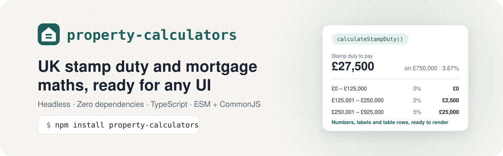
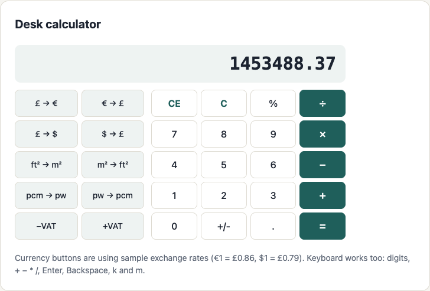

<div align="center">

<picture>
  <source media="(prefers-color-scheme: dark)" srcset="assets/banner-dark.svg">
  <source media="(prefers-color-scheme: light)" srcset="assets/banner-light.svg">
  
</picture>

<br/>

[](package.json)
[](#api-reference)
[](#install)
[](#the-rates)
[](LICENSE)

</div>

## What is this?

Every UK property site ends up needing the same three things: a stamp duty calculator, a mortgage
calculator, and something to turn a weekly rent into a monthly one. And every team writes them
again, gets a band edge wrong, and finds out from a customer.

**property-calculators** is that logic, written once and tested hard. You call a function. It
hands back the numbers, plus everything you'd otherwise write yourself to show them: formatted
strings, labels, table columns and rows, form options, even the calculator's button grid.

The core is **headless**: your design system draws the UI and this tells it what to draw. In a
hurry? There are also [ready-made React components](#react-components) that look finished out of
the box and restyle with a few CSS variables.

```ts
import { calculateStampDuty } from 'property-calculators';

const estimate = calculateStampDuty({ price: 750_000 });

estimate.stampDuty;               // 27500
estimate.formatted.stampDuty;     // "£27,500"
estimate.formatted.effectiveRate; // "3.67%"
estimate.bands[2].formatted;      // { range: "£250,001 – £925,000", rate: "5%", taxable: "£500,000", tax: "£25,000" }
```

## What's inside

| | | |
| --- | --- | --- |
| **[Stamp duty](#stamp-duty)** | SDLT for home movers, first-time buyers, additional properties and non-UK residents, with the band-by-band breakdown. Also [new leases](#new-leases), [non-residential property](#non-residential-and-mixed-use) and [replacing a main home](#replacing-a-main-residence). | `property-calculators` |
| **[Mortgage](#mortgage)** | Monthly payment, total interest, loan to value, and the cash you need upfront with stamp duty included. | `property-calculators/mortgage` |
| **[Desk calculator](#desk-calculator)** | A pocket calculator that also does VAT, rent per week ↔ per month, ft² ↔ m², and £ ↔ € or $. | `property-calculators/calculator` |
| **[React components](#react-components)** | All three as drop-in components, styled by default and themeable. Optional. | `property-calculators/react` |

- **Headless core.** Works with React, Vue, Svelte, a server template, a CLI or a spreadsheet export.
- **Zero dependencies.** About 11 kB gzipped for all three calculators, less if you import one. React is only needed if you use the components.
- **Runs anywhere.** Node 18+, browsers, edge runtimes, React Native. ESM and CommonJS, fully typed.
- **Plain JSON out.** Stamp duty and mortgage results cross an API or a server-to-client boundary untouched.
- **Deterministic.** No `Intl`, no locale lookups: the server and the browser always print the same string.

> [!IMPORTANT]
> Results are estimates, not tax or financial advice. "Stamp duty" here is SDLT, which applies in
> **England and Northern Ireland**. Scotland (LBTT) and Wales (LTT) have their own taxes and are
> not covered. See [what it doesn't cover](#what-it-doesnt-cover).

## See it running

The repo includes a small Next.js app with two pages: the ready-made components with a theme
switcher, and the same calculators hand-built from the library's data.

```sh
npm install
npm run demo        # http://localhost:3000
```

<table>
<tr>
<td width="50%" valign="top">
<picture>
  <source media="(prefers-color-scheme: dark)" srcset="assets/demo-stamp-duty-dark.png">
  
</picture>
</td>
<td width="50%" valign="top">
<picture>
  <source media="(prefers-color-scheme: dark)" srcset="assets/demo-mortgage-dark.png">
  
</picture>
<br/><br/>
<picture>
  <source media="(prefers-color-scheme: dark)" srcset="assets/demo-calculator-dark.png">
  
</picture>
</td>
</tr>
</table>

Each of those is around a hundred lines of JSX with no maths in it. Read them in
[`demo/app/components`](demo/app/components).

## Install

```sh
npm install property-calculators
```

```ts
import { calculateStampDuty, getMortgageSummary } from 'property-calculators';
import { createCalculator, CALCULATOR_LAYOUT } from 'property-calculators/calculator';
```

| Entry point | Contains |
| --- | --- |
| `property-calculators` | Stamp duty and mortgage, plus the desk calculator under the `calculator` namespace |
| `property-calculators/stamp-duty` | Stamp duty only |
| `property-calculators/mortgage` | Mortgage only |
| `property-calculators/calculator` | Desk calculator only |
| `property-calculators/react` | Ready-made React components (needs React 18 or later) |
| `property-calculators/styles.css` | The components' default stylesheet, for when you'd rather load it yourself |

---

## React components

Three components, one import, no CSS file to load and nothing to configure.

```tsx
import { DeskCalculator, MortgageCalculator, StampDutyCalculator } from 'property-calculators/react';

<StampDutyCalculator defaultPrice={750_000} />
<MortgageCalculator defaultPrice={500_000} />
<DeskCalculator rates={[{ currency: 'EUR', value: 0.86 }, { currency: 'USD', value: 0.79 }]} />
```

They are accessible (every control is labelled, results are announced, the keypad has spoken
names), responsive down to phone width, and work with server rendering and the Next.js App Router.

<table>
<tr>
<td width="33%" valign="top"><br/><sub><b>Default</b>: no props</sub></td>
<td width="33%" valign="top"><br/><sub><b>Dark</b>: <code>theme="dark"</code></sub></td>
<td width="33%" valign="top"><br/><sub><b>Yours</b>: five CSS variables</sub></td>
</tr>
</table>

### Make them yours

Pick whichever of these fits how you already style things. They combine.

**1. CSS variables**, for matching a brand in a minute. Set them on the component or any ancestor:

```tsx
<StampDutyCalculator
    style={{
        '--pc-accent': '#b4232a',
        '--pc-soft': '#fbeeee',
        '--pc-line': '#e7caca',
        '--pc-radius': '2px',
        '--pc-font': 'Georgia, serif',
    }}
/>
```

| Variable | Controls | Default |
| --- | --- | --- |
| `--pc-accent` | Selected options, operator keys, the headline figure | `#1f5f5b` |
| `--pc-accent-ink` | Text on the accent colour | `#ffffff` |
| `--pc-ink` | Main text | `#1c2330` |
| `--pc-muted` | Labels and secondary text | `#5d6675` |
| `--pc-surface` | Inputs and keys | `#ffffff` |
| `--pc-soft` | Result tiles, the display, conversion keys | `#eef3f2` |
| `--pc-line` | Borders and dividers | `#dedbd2` |
| `--pc-radius` | Corner radius | `8px` |
| `--pc-gap` | Spacing between fields | `16px` |
| `--pc-font`, `--pc-mono` | Typefaces | system fonts |

**2. Themes.** `theme="dark"`, or `theme="auto"` to follow the visitor's system setting.

**3. Your own classes per part**, which is the natural fit for Tailwind. They are added after the
built-in class:

```tsx
<MortgageCalculator
    className="rounded-xl p-6 shadow"
    classNames={{ input: 'rounded-none border-black', row: 'py-3', hint: 'text-red-600' }}
/>
```

Parts: `root`, `form`, `field`, `label`, `money`, `prefix`, `input`, `select`, `options`,
`option`, `check`, `summary`, `summaryItem`, `heading`, `table`, `rows`, `row`, `hint`,
`display`, `pads`, `pad`, `key`.

**4. Start from nothing.** `unstyled` drops the default styles for that component. Every element
keeps a stable `pc-*` class (`pc-input`, `pc-key`, `pc-summary-item`, ...) and useful data
attributes (`data-variant` on keys, `data-checked` on options, `data-lead` on the headline row),
so you can write the CSS from scratch.

```tsx
<DeskCalculator unstyled className="my-calculator" />
```

The default rules are written so that none of them outrank a single class of yours: you never
need `!important` to override one.

### Props

All three accept `className`, `classNames`, `theme`, `unstyled`, `inlineStyles`, and any ordinary
`div` attribute (`id`, `style`, `data-*`), which lands on the root element.

| Component | Props |
| --- | --- |
| `StampDutyCalculator` | `defaultPrice`, `defaultBuyer`, `defaultNonUkResident`, `showBreakdown` (default `true`), `onChange(estimate \| null)` |
| `MortgageCalculator` | `defaultPrice`, `defaultDeposit` (default 25% of the price), `defaultRate`, `defaultTermYears`, `defaultType`, `defaultBuyer`, `onChange(summary \| null)` |
| `DeskCalculator` | `rates`, `keyboard` (default `true`), `conversions` (default `true`), `calculator` (your own store from `createCalculator()`) |

`onChange` hands you the same objects the headless functions return, so you can react to a result
elsewhere on the page:

```tsx
<StampDutyCalculator onChange={(estimate) => setStampDuty(estimate?.stampDuty ?? null)} />
```

> [!NOTE]
> The styles travel inside the components as a `<style>` tag. If your site's Content Security
> Policy blocks inline styles, import `property-calculators/styles.css` yourself and pass
> `inlineStyles={false}`.

When the components don't bend far enough, drop down a level: everything below is what they are
built from.

---

## Stamp duty

### One call

```ts
import { calculateStampDuty } from 'property-calculators';

const estimate = calculateStampDuty({
    price: 750_000,
    buyer: 'home-mover',   // or 'first-time-buyer' | 'additional-property'
    nonUkResident: false,  // true adds the 2% surcharge
});
```

```jsonc
{
    "price": 750000,
    "buyer": "home-mover",
    "nonUkResident": false,
    "stampDuty": 27500,
    "effectiveRate": 3.6666666666666665,
    "formatted": { "price": "£750,000", "stampDuty": "£27,500", "effectiveRate": "3.67%" },
    "bands": [
        {
            "from": 0, "to": 125000, "rate": 0, "taxable": 125000, "tax": 0,
            "formatted": { "range": "£0 – £125,000", "rate": "0%", "taxable": "£125,000", "tax": "£0" }
        },
        {
            "from": 125000, "to": 250000, "rate": 2, "taxable": 125000, "tax": 2500,
            "formatted": { "range": "£125,001 – £250,000", "rate": "2%", "taxable": "£125,000", "tax": "£2,500" }
        }
        // ... one per band. The open-ended top band has "to": null.
    ]
}
```

Only `price` is required. A price that is negative or not a finite number throws a `RangeError`.

The same £750,000 home, six ways:

| Buyer | UK resident | Non-UK resident |
| --- | ---: | ---: |
| Home mover | £27,500 | £42,500 |
| First-time buyer (no relief above £500,000) | £27,500 | £42,500 |
| Additional property | £65,000 | £80,000 |

### From result to interface

`getStampDutyTable` arranges an estimate for display: headline figures, then the breakdown as
columns and rows of strings.

```tsx
import { BUYER_TYPES, calculateStampDuty, getStampDutyTable } from 'property-calculators';

function StampDuty({ price, buyer, onBuyerChange }) {
    const { summary, columns, rows, totals } = getStampDutyTable(calculateStampDuty({ price, buyer }));

    return (
        <>
            <select value={buyer} onChange={(e) => onBuyerChange(e.target.value)}>
                {BUYER_TYPES.map((b) => <option key={b.value} value={b.value}>{b.label}</option>)}
            </select>

            <dl>
                {summary.map((item) => (
                    <div key={item.key}><dt>{item.label}</dt><dd>{item.formatted}</dd></div>
                ))}
            </dl>

            <table>
                <thead>
                    <tr>{columns.map((c) => <th key={c.key}>{c.label}</th>)}</tr>
                </thead>
                <tbody>
                    {rows.map((row) => (
                        <tr key={row.key}>{columns.map((c) => <td key={c.key}>{row[c.key]}</td>)}</tr>
                    ))}
                </tbody>
                <tfoot>
                    <tr>{columns.map((c) => <td key={c.key}>{totals[c.key]}</td>)}</tr>
                </tfoot>
            </table>
        </>
    );
}
```

That is the whole component. Swap the tags for your own design system's.

### Listing pages

Search results and property pages usually want one figure, not a breakdown.

```ts
import { getStaticStampDuty, stampDutyByPrice, stampDutyFor } from 'property-calculators';

stampDutyFor(895_000);                 // 34750
stampDutyFor(null);                    // null  (no price, nothing to show)

stampDutyByPrice([650_000, 895_000, null]);
// { 650000: 22500, 895000: 34750 }    one lookup for a whole page of cards

getStaticStampDuty(1_250_000);         // "Stamp Duty £68,750"
getStaticStampDuty(1_250_000, 1);      // null  (qualifier 1 = price on application)
```

### Form state

A tiny reducer for a calculator form. It knows that "second home" and "first-time buyer" can't
both be ticked, and clears one when you set the other.

```ts
import { canCalculate, initialState, methods } from 'property-calculators';

let state = methods(initialState).price(750_000);
state = methods(state).secondHome(true);

canCalculate(state);               // true
state = methods(state).calculate();

state.stampDuty;                   // 65000
state.bands;                       // the per-band breakdown
```

It is plain functions, so it drops into `useReducer`, a store, or react-use's
`useMethods(methods, initialState)`. `STAMP_DUTY_FIELDS` describes the three checkboxes (name,
label, which state key each one drives).

### Serving it over HTTP

Two helpers build a response body and a PDF model from a request, so a route is one line.

```ts
import { getStampDutyPdfModel, getStampDutyResponse } from 'property-calculators';

// GET /api/stamp-duty/750000?ukResident=true&firstTimeBuyer=false&secondHome=false
return Response.json(getStampDutyResponse({ ...query, price }));

// GET /api/stamp-duty/pdf/:hash?address=...     hash = base64 JSON of the same fields
const model = getStampDutyPdfModel({ hash, address });
// { address, price, stampDuty, actualRate, bands }: hand it to your PDF library
```

Two things to know about `getStampDutyResponse`:

- A flag is on only when it is exactly `"true"`, and **`ukResident` is off unless you send it**.
  Always send all three flags.
- It does not validate the price: nonsense in gives zeros out, and a negative price throws. Check
  the price before calling it, as the [demo route](demo/app/api/stamp-duty/%5Bprice%5D/route.ts) does.
  For new work, prefer returning `calculateStampDuty(...)`, which validates and has the cleaner shape.

`getStampDutyPdfModel` throws a `TypeError` for a hash that isn't a base64 JSON object.
`encodeStampDutyHash` builds one.

### The rates

Rates in force **from 1 April 2025** (`SDLT_RATES_EFFECTIVE_FROM`). Each rate applies only to the
slice of the price inside its band.

| Slice of the price | Standard | Additional property | First-time buyer¹ |
| --- | ---: | ---: | ---: |
| Up to £125,000 | 0% | 5% | 0% |
| £125,001 to £250,000 | 2% | 7% | 0% |
| £250,001 to £300,000 | 5% | 10% | 0% |
| £300,001 to £500,000 | 5% | 10% | 5% |
| £500,001 to £925,000 | 5% | 10% | — |
| £925,001 to £1.5 million | 10% | 15% | — |
| Above £1.5 million | 12% | 17% | — |

¹ First-time buyer relief applies only to homes of £500,000 or less. Above that, standard rates
apply to the whole price.

- **Non-UK residents** pay 2 percentage points more in every band, on top of any other rate.
- **Under £40,000** nothing is due, and the surcharges don't apply.

The tables themselves are exported as `BAND_TABLES` if you want to render a rates page. Check them
against [GOV.UK's residential rates](https://www.gov.uk/stamp-duty-land-tax/residential-property-rates)
before relying on them after a Budget.

### New leases

Buying a new lease is taxed twice: once on the **premium** (the lump sum, taxed like a purchase
price) and once on the **rent**. The rent is taxed through its *net present value*: every year's
rent, discounted by 3.5% a year back to today, added up over the whole lease.

```ts
import { calculateLeaseStampDuty, getLeaseStampDutyTable } from 'property-calculators';

const lease = calculateLeaseStampDuty({
  premium: 275_000,
  rent: 10_000,       // per year; or up to five numbers for the first five years
  termYears: 99,
});

lease.premium.stampDuty;   // 3750    tax on the premium, with lease.premium.bands
lease.rent.npv;            // 276233  net present value of the rent
lease.rent.tax;            // 1512    1% of the value above £125,000
lease.stampDuty;           // 5262
lease.formatted.stampDuty; // "£5,262"

getLeaseStampDutyTable(lease); // { summary, columns, premium: { rows, totals }, rent: { rows, totals }, notes }
```

It takes the same `buyer`, `nonUkResident`, `propertyType` and `dwellings` options as
`calculateStampDuty`, and applies the lease rules for you:

| Rule | What happens |
| --- | --- |
| Additional-property surcharge | Charged on the premium only, never on rent. |
| Non-UK resident surcharge | Adds 2 points to the rent bands as well (2% and 3%). Needs a premium of £40,000 or a rent of £1,000 a year. |
| Lease of 7 years or fewer | Neither surcharge applies. |
| First-time buyer relief | Premium only, and only for a lease of 21 years or more. |
| Rent after year five | Uses the highest rent of the first five years. |

When a relief or surcharge you asked for is not applied, `lease.notes` says why in plain English,
and `lease.applied` records what was charged. Need only the rent figure? `calculateRentNpv({ rent, termYears })`.

An existing lease that is sold on is taxed on its price alone: use `calculateStampDuty` for that.

### Non-residential and mixed use

Shops, offices, farmland and mixed property (a flat above a shop) have their own table, with no
reliefs or surcharges.

```ts
calculateStampDuty({ price: 275_000, propertyType: 'non-residential' }).stampDuty; // 3250
```

| Slice of the price | Rate |
| --- | ---: |
| Up to £150,000 | 0% |
| £150,001 to £250,000 | 2% |
| Above £250,000 | 5% |

Six or more dwellings bought in one transaction are taxed at these rates too. Pass `dwellings`
and the switch happens for you; `estimate.propertyType` tells you which table was used.

```ts
calculateStampDuty({ price: 2_000_000, dwellings: 6 }).propertyType; // "non-residential"
```

Rent on a new non-residential lease is charged at 0% up to £150,000 of net present value, 1% to
£5 million and 2% above: `calculateLeaseStampDuty({ ..., propertyType: 'non-residential' })`.

### Replacing a main residence

Someone who already owns a property pays the additional-property rates, unless the purchase
replaces their main home and the old one is already sold. `resolveBuyer` turns the yes/no answers
into the buyer type, with a sentence to show the user. `BUYER_QUESTIONS` has the question wording.

```ts
import { resolveBuyer, getHigherRatesRefund, getRefundDeadlines } from 'property-calculators';

const answer = resolveBuyer({
  ownsOtherProperty: true,
  replacingMainResidence: true,
  previousHomeSold: false,
});

answer.buyer;          // "additional-property"
answer.refundPossible; // true
answer.explanation;    // "Your previous main residence is not sold yet, so the higher rates apply. You can claim…"

calculateStampDuty({ price: 600_000, buyer: answer.buyer }).stampDuty; // 50000
```

If the old home sells within three years, the extra can be claimed back:

```ts
getHigherRatesRefund({ price: 600_000 });
// { paid: 50000, standard: 20000, refund: 30000, formatted: { refund: "£30,000", … } }

getRefundDeadlines({ purchaseDate: '2025-06-10', saleDate: '2026-02-01' });
// { sellBy: "2028-06-10", filingDate: "2025-06-24", claimBy: "2027-02-01", soldInTime: true }
```

### What it doesn't cover

The calculator handles one person or couple buying a home, a new lease, or non-residential
property. It does not model:

- Scotland or Wales
- Purchases by companies (including the flat 17% rate on homes over £500,000)
- Shared ownership and linked transactions
- Rates before 1 April 2025
- Rent under an assured tenancy, which is excluded from the rent charge from 1 May 2026
- Every exception to the surcharges (trusts, partnerships, separated spouses and so on)

---

## Mortgage

```ts
import { getMortgageSummary } from 'property-calculators/mortgage';

const { summary, error } = getMortgageSummary({
    price: 500_000,
    deposit: 100_000,
    rate: 5,              // annual, percent
    termYears: 25,
    type: 'repayment',    // or 'interest-only'
    buyer: 'home-mover',  // optional: buyer type for the stamp duty
});
```

You get either a `summary` or an `error`, never both. The error is a sentence written for the
form, such as `"Enter an interest rate between 0% and 25%."`

`summary.rows` is the result in display order:

| `label` | `formatted` |
| --- | ---: |
| Monthly payment | £2,338.36 |
| Loan amount | £400,000 |
| Loan to value | 80% |
| Total interest | £301,508 |
| Total repaid | £701,508 |
| Deposit | £100,000 |
| Stamp duty | £15,000 |
| Cash needed upfront | £115,000 |

```tsx
{summary
    ? summary.rows.map((row) => <Row key={row.key} label={row.label} value={row.formatted} />)
    : <FormError>{error}</FormError>}
```

Every figure is also on `summary` as a number (`summary.monthlyPayment`) and in
`summary.formatted` as a string.

**How it's worked out.** Repayment mortgages use the standard annuity formula with monthly
compounding; interest-only pays the interest each month and the loan at the end. One rate is
assumed for the whole term. "Cash needed upfront" is the deposit plus stamp duty; legal fees,
surveys and lender fees are extra.

Helpers for the form: `REPAYMENT_TYPES` (select options), `MORTGAGE_DEFAULTS`, `MORTGAGE_LIMITS`
(min and max for rate and term), `depositFromPercent(price, 10)` and `depositPercentOf(price, deposit)`
for a pounds-or-percent deposit field, and `calculateMortgage` if you only want the maths.

---

## Desk calculator

A pocket calculator with the conversions property people reach for all day:

| Button | Does | Example |
| --- | --- | --- |
| `+VAT` / `−VAT` | Adds or removes 20% VAT | 1,200,000 → 1,440,000 |
| `pw → pcm` / `pcm → pw` | Weekly rent to monthly and back | 2,500 pw → 10,833 pcm |
| `ft² → m²` / `m² → ft²` | Floor area | 850 ft² → 78.97 m² |
| `£ → €`, `£ → $` and back | Currency, at rates you supply | |
| `k`, `m` keys | Thousands and millions | `1.2m` → 1,200,000 |

The library holds the state and describes the buttons. You draw them.

```tsx
import { CALCULATOR_LAYOUT, createCalculator } from 'property-calculators/calculator';
import { useState, useSyncExternalStore } from 'react';

function Calculator() {
    const [calculator] = useState(() => createCalculator());
    useSyncExternalStore(calculator.subscribe, calculator.getState, calculator.getState);

    return (
        <>
            <output>{calculator.getDisplay()}</output>

            {[CALCULATOR_LAYOUT.extra, CALCULATOR_LAYOUT.basic].map((group) => (
                <div key={group.columns} style={{ display: 'grid', gridTemplateColumns: `repeat(${group.columns}, 1fr)` }}>
                    {group.buttons.map((button) => (
                        <button
                            key={button.id}
                            aria-label={button.ariaLabel}
                            data-variant={button.variant}
                            disabled={button.requiresRates && !calculator.hasRates()}
                            onClick={() => calculator.input(button.value)}
                        >
                            {button.label}
                        </button>
                    ))}
                </div>
            ))}
        </>
    );
}
```

Each button carries an `id`, a `label` (`"ft² → m²"`), an `ariaLabel` (`"Square feet to square
metres"`), a `variant` to style by (`digit`, `operator`, `clear`, `function`) and a `value` to
pass back on click. Conversions also have `from` and `to` so you can style the two sides of the arrow.

**Keyboard.** `press` takes a key and tells you whether the calculator used it:

```ts
window.addEventListener('keydown', (event) => {
    if (calculator.press(event.key)) event.preventDefault();
});
```

Digits, `+ - * /`, `Enter` or `=`, `%`, `.`, `Backspace`, `k` and `m` are handled. `CALCULATOR_KEYS`
lists them for a shortcuts hint.

**Exchange rates.** The library doesn't fetch anything. Give it rates from wherever you get them;
each `value` is what one unit of the currency is worth in pounds. Until you do, the currency
buttons do nothing, and `requiresRates` lets you disable them.

```ts
calculator.setRates([
    { currency: 'EUR', value: 0.86 },
    { currency: 'USD', value: 0.79 },
]);
```

**Not using React?** `createCalculator()` is a plain store: `getState`, `getDisplay`, `input`,
`press`, `setRates`, `subscribe`. If you'd rather own the state, `reducer`, `bindActions` and
`getInitialState` plug into any reducer setup, and `constructExpression(expression, input, meta)`
is the pure function underneath it all.

> [!NOTE]
> Button values are JavaScript symbols, so calculator state can't be serialised to JSON or sent
> between a server and a client. Create the calculator in the browser. Very large results are
> shown in scientific notation (`4.3e+25`).

---

## Recipes

<details>
<summary><b>Next.js server component</b>: stamp duty on a listing page, no client JavaScript</summary>

```tsx
import { calculateStampDuty, getStampDutyTable } from 'property-calculators';

export default async function Listing({ params }) {
    const listing = await getListing((await params).id);
    const { summary } = getStampDutyTable(calculateStampDuty({ price: listing.price }));

    return (
        <aside>
            {summary.map((item) => (
                <p key={item.key}>{item.label}: <strong>{item.formatted}</strong></p>
            ))}
        </aside>
    );
}
```

</details>

<details>
<summary><b>API route</b>: a validated JSON endpoint</summary>

```ts
import { calculateStampDuty, isBuyerType, parsePriceParam } from 'property-calculators';

export function GET(request: Request) {
    const params = new URL(request.url).searchParams;
    const price = parsePriceParam(params.get('price'));
    const buyer = params.get('buyer') ?? 'home-mover';

    if (price === null || !isBuyerType(buyer))
        return Response.json({ error: 'Send a price in whole pounds and a valid buyer type.' }, { status: 400 });

    return Response.json(
        calculateStampDuty({ price, buyer, nonUkResident: params.get('nonUkResident') === 'true' }),
    );
}
```

</details>

<details>
<summary><b>Live price input</b>: recalculate as the user types</summary>

```tsx
import { calculateStampDuty, parsePrice } from 'property-calculators';

function QuickStampDuty() {
    const [text, setText] = useState('');
    const price = parsePrice(text);   // "£1,250,000" -> 1250000

    return (
        <>
            <input inputMode="decimal" value={text} onChange={(e) => setText(e.target.value)} />
            {price > 0 && <p>{calculateStampDuty({ price }).formatted.stampDuty}</p>}
        </>
    );
}
```

The calculation is synchronous and fast, so there is nothing to debounce or cache.

</details>

<details>
<summary><b>Node script</b>: no framework at all</summary>

```js
const { calculateStampDuty } = require('property-calculators');

for (const band of calculateStampDuty({ price: 1_600_000, buyer: 'additional-property' }).bands)
    console.log(band.formatted.range.padEnd(26), band.formatted.rate.padStart(4), band.formatted.tax.padStart(10));
```

</details>

---

## Accuracy

Tax software has to be boring. This is what stands behind the numbers:

- **Whole-pound rounding.** Tax is rounded down to the pound. The calculation multiplies before
  it divides, so floating point never shaves a pound off. (A naive `price / 100 * rate` gets
  £925,820 at additional-property rates wrong by £1.)
- **Checked against HMRC's own examples.** The rent calculation reproduces the worked example in
  HMRC's manual (SDLTM13080) to the pound, and the non-residential table GOV.UK's £275,000 example.
- **Every band edge is tested.** For all six buyer combinations, every pound within £1,500 of
  every threshold is compared against exact integer arithmetic.
- **The breakdown always adds up.** The taxable slices sum to the price, and the per-band tax
  sums to the total.
- **The calculator can't be crashed from the keypad.** Thousands of random button sequences run
  in the test suite, including dividing by zero and converting currency with no rates.
- **Input from the outside world is checked.** Invalid prices and malformed hashes fail with a
  clear error, not a wrong answer.

Run the suite yourself with `npm test`.

## API reference

<details>
<summary><b>Stamp duty</b></summary>

| Export | Description |
| --- | --- |
| `calculateStampDuty(input)` | Estimate with breakdown and display strings. Throws `RangeError` on an invalid price or buyer. |
| `getStampDutyTable(estimate)` | `{ summary, columns, rows, totals }` as strings. |
| `stampDutyFor(price, options?)` | The amount, or `null` if the price is missing or not positive. |
| `stampDutyByPrice(prices, options?)` | `{ [price]: amount }` for the valid prices in a list. |
| `getStaticStampDuty(price, qualifier?)` | `"Stamp Duty £43,750"`, or `null`. |
| `BUYER_TYPES`, `DEFAULT_BUYER_TYPE`, `isBuyerType` | Buyer options and a type guard. |
| `toBandOptions`, `fromBandOptions` | Convert between a buyer type and the three boolean flags. |
| `STAMP_DUTY_FIELDS`, `STAMP_DUTY_LABELS`, `STAMP_DUTY_COLUMNS` | Checkbox definitions, labels, table columns. |
| `methods`, `initialState`, `canCalculate` | Form state. |
| `getBands(price, flags)`, `getStampDuty(price, bands)`, `computeActualRate(price, bands)` | The primitives. `ukResident` must be `true` to avoid the surcharge. |
| `BAND_TABLES`, `SDLT_JURISDICTION`, `SDLT_RATES_EFFECTIVE_FROM` | The rate tables and what they apply to. |
| `calculateLeaseStampDuty(input)` | Tax on a new lease: premium plus rent, with both breakdowns, `applied` and `notes`. |
| `calculateRentNpv({ rent, termYears })` | Net present value of the rent, rounded down to the pound. |
| `getLeaseStampDutyTable(lease)`, `LEASE_LABELS` | A lease result as summary rows and two tables of strings. |
| `PROPERTY_TYPES`, `isPropertyType`, `resolvePropertyType` | Residential or non-residential, and the six-dwellings rule. |
| `NON_RESIDENTIAL_BANDS`, `RESIDENTIAL_RENT_BANDS`, `NON_RESIDENTIAL_RENT_BANDS` | The non-residential and rent rate tables. |
| `resolveBuyer(answers)`, `BUYER_QUESTIONS` | Buyer type from yes/no answers, with the reason. |
| `getHigherRatesRefund({ price })` | The surcharge that can be claimed back when a previous home sells. |
| `getRefundDeadlines({ purchaseDate, saleDate? })` | Sell-by, filing and claim-by dates. |
| `getStampDutyResponse(query)`, `parseStampDutyQuery(query)` | HTTP response body from query-string flags. |
| `getStampDutyPdfModel({ hash, address })`, `encodeStampDutyHash`, `decodeStampDutyHash` | PDF model and its URL hash. |
| `isValidPrice`, `parsePriceParam`, `parsePrice`, `MAX_PRICE` | Validation and parsing. |
| `formatPounds`, `formatPoundsAndPence`, `formatRate`, `formatBandRange` | `£1,250,000`, `£2,338.36`, `12.5%`, `£125,001 – £250,000`. |
| `formatPrice`, `formatPercentage`, `formatRange`, `formatNumber` | Fixed-decimal variants: `£43,750.00`, `5.00%`. |

Types: `StampDutyInput`, `StampDutyEstimate`, `StampDutyBand`, `BuyerType`, `PropertyType`,
`LeaseStampDutyInput`, `LeaseStampDuty`, `RentInput`, `BuyerAnswers`, `BuyerResolution`,
`HigherRatesRefund`, `RefundDeadlines`, `Band`,
`CalculatedBand`, `BandOptions`, `State`, `StampDutyResponse`, `StampDutyPdfModel`.

</details>

<details>
<summary><b>Mortgage</b></summary>

| Export | Description |
| --- | --- |
| `getMortgageSummary(input)` | `{ summary, error }` with stamp duty, cash upfront, display strings and rows. |
| `calculateMortgage(input)` | The maths alone; `null` for invalid input. |
| `mortgageInputError(input)` | The reason an input can't be calculated, or `null`. |
| `depositFromPercent(price, percent)`, `depositPercentOf(price, deposit)` | Convert a deposit between pounds and percent. |
| `REPAYMENT_TYPES`, `MORTGAGE_DEFAULTS`, `MORTGAGE_LIMITS`, `MORTGAGE_LABELS` | Options, defaults, bounds and labels. |

Types: `MortgageInput`, `MortgageSummaryInput`, `MortgageResult`, `MortgageSummary`, `RepaymentType`.

</details>

<details>
<summary><b>React components</b></summary>

| Export | Description |
| --- | --- |
| `StampDutyCalculator`, `MortgageCalculator`, `DeskCalculator` | The components. See [props](#props). |
| `STYLES` | The default stylesheet as a string, the same content as `property-calculators/styles.css`. |

Types: `StampDutyCalculatorProps`, `MortgageCalculatorProps`, `DeskCalculatorProps`, `BaseProps`,
`ClassNames`, `Slot`.

</details>

<details>
<summary><b>Desk calculator</b></summary>

| Export | Description |
| --- | --- |
| `createCalculator(initial?)` | A store: `getState`, `getDisplay`, `hasRates`, `input`, `press`, `setRates`, `subscribe`. |
| `CALCULATOR_LAYOUT`, `BASIC_BUTTONS`, `EXTRA_BUTTONS` | The buttons as data, in grid order. |
| `CALCULATOR_KEYS`, `CALCULATOR_TEXT`, `CONVERSIONS` | Keyboard shortcuts, supporting copy, conversion factors. |
| `operation` | The symbol for each operation, if you build buttons by hand. |
| `reducer`, `bindActions`, `getInitialState`, `getDisplay`, `hasRates` | For owning the state yourself. |
| `constructExpression`, `getExpression`, `mapKey`, `mapCurrencies` | The pure engine. |

Types: `Calculator`, `CalculatorState`, `CalculatorButton`, `CalculatorInput`, `ExchangeRate`, `Rates`.

</details>

## Questions

**Should I use the components or the headless functions?**
Use the components to get a calculator on the page today. Use the functions when the design has
to match exactly, when you're not on React, or when the output isn't a web page at all (an email,
a PDF, a mobile app). Both give the same numbers, because the components are built on the functions.

**Do I need React?**
Only for `property-calculators/react`. Everything else has no dependencies at all.

**Does it call any API?**
No. Everything is computed locally and synchronously. The only outside data it ever uses is the
exchange rates you pass to the desk calculator.

**What happens when the Chancellor changes the rates?**
The tables in [`src/stamp-duty/bands`](src/stamp-duty/bands) are updated, a new version is
released, and you upgrade. `SDLT_RATES_EFFECTIVE_FROM` tells you which rates a given version has,
so you can show "rates from 1 April 2025" next to your calculator.

**Can I use the formatters on their own?**
Yes. `formatPounds`, `formatRate` and friends are exported and have no ties to the calculators.

**Is it safe to render the strings as HTML?**
The library only ever returns digits, punctuation, currency signs and its own fixed labels. An
address you pass to the PDF model comes back unchanged, so escape it as you would any user input.

## Contributing

```sh
npm install
npm test            # vitest
npm run type-check
npm run lint        # formatting, and no file over 250 lines
npm run format      # fix formatting
npm run build       # ESM, CommonJS and type declarations into dist/
npm run demo        # the Next.js demo; add `npm run build:watch` in another terminal for live edits
```

**Changing the rates.** Update the tables in `src/stamp-duty/bands/`, set
`SDLT_RATES_EFFECTIVE_FROM`, fix the expected figures in `tests/`, update [the rates table](#the-rates)
above, and add a line to the [changelog](CHANGELOG.md).

Bug reports are most useful with the exact input and the figure you expected, ideally with a link
to the GOV.UK guidance or HMRC calculator result that backs it up.

## Licence

[MIT](LICENSE). Use it, change it, ship it.

<br/>

<div align="center">


<sub>Estimates, not advice. Always confirm the figures for a real purchase with a solicitor and lender.</sub><br/>
<sub><a href="CHANGELOG.md">Changelog</a> · <a href="assets/README.md">Brand assets</a> · <a href="demo">Demo app</a></sub>

</div>
